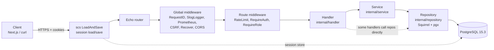
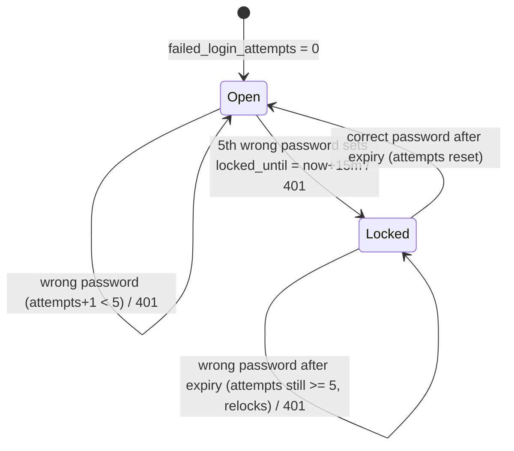
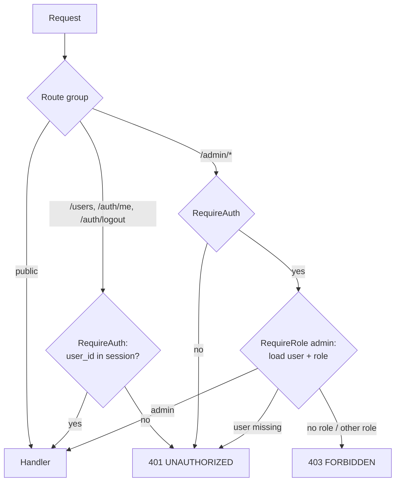
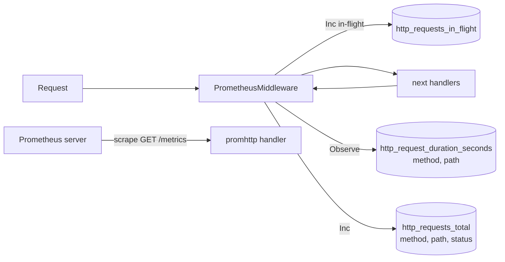
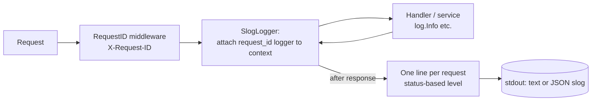
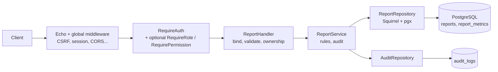
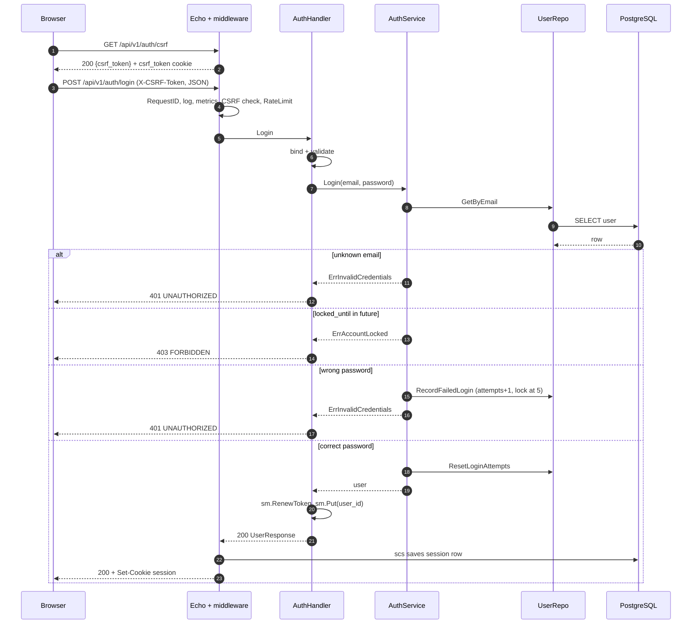
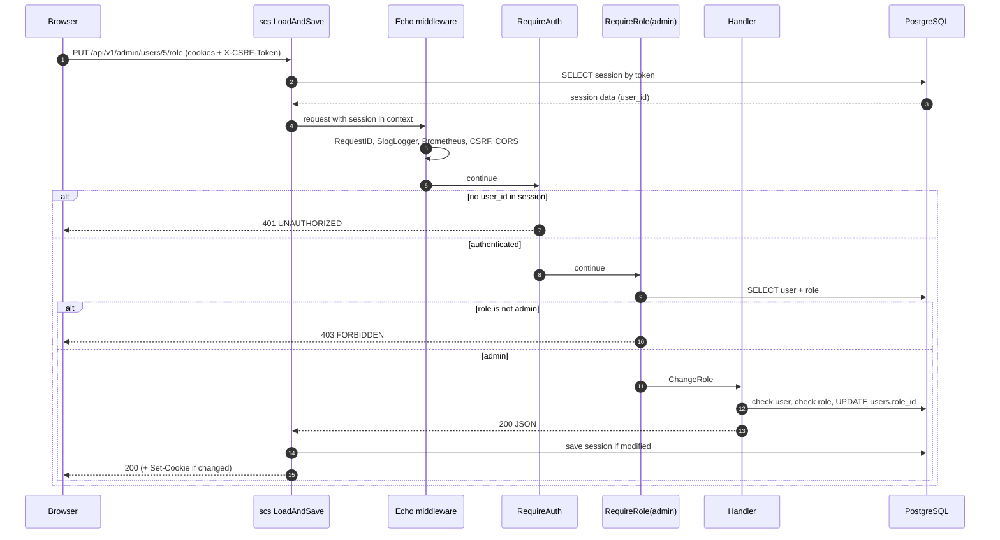

# App Flow
## Pastoral Reports Backend

**Version:** 1.0
**Date:** 2026-10-11
**Status:** Draft
**Repository:** github.com/ssr0016/pastoral-reports/backend

> **How to read this document**
> - **Part 1** describes what the Go code does **today** (commit `f40e94c`). It was written from the source files and, where noted, confirmed against a running server.
> - **Part 2** is **PROPOSED, not implemented**. It designs the Reports feature using the Express/MongoDB analysis (`Express_MongoDB_Report_Backend_Analysis.docx`) as the functional reference.
> - Findings marked **[Observed]** were reproduced on a live server; **[Code]** were read from source only.

---

## Table of Contents

- [Part 1: Current State (Authentication & RBAC)](#part-1-current-state-authentication--rbac)
  - [1. System Architecture](#1-system-architecture)
  - [2. Middleware Chain](#2-middleware-chain)
  - [3. Authentication Flows](#3-authentication-flows)
  - [4. Session Lifecycle](#4-session-lifecycle)
  - [5. Authorization Flows](#5-authorization-flows)
  - [6. RBAC Matrix](#6-rbac-matrix)
  - [7. Request / Response Flows](#7-request--response-flows)
  - [8. Complete Route List](#8-complete-route-list)
  - [9. Prometheus Metrics Flow](#9-prometheus-metrics-flow)
  - [10. Logging Flow](#10-logging-flow)
- [Part 2: Proposed Reports Feature](#part-2-proposed-reports-feature-proposed--not-yet-implemented)
  - [11. Reports Flow Overview](#11-reports-flow-overview)
  - [12. Report Data Flow and Schema Mapping](#12-report-data-flow-and-schema-mapping)
  - [13. Proposed API Endpoints](#13-proposed-reports-api-endpoints)
  - [14. Proposed Reports Flows](#14-proposed-reports-flows)
  - [15. Proposed Authorization Matrix](#15-proposed-report-authorization-matrix)
  - [16. Proposed Audit Logging](#16-proposed-report-audit-logging)
  - [17. Proposed Validation Rules](#17-proposed-report-validation-rules)
  - [18. Differences from the Express Reference](#18-differences-from-the-express-reference)
- [Part 3: Diagrams](#part-3-diagrams)
- [Part 4: Open Questions](#part-4-open-questions)

---

# Part 1: Current State (Authentication & RBAC)

## 1. System Architecture



| Layer | Package / file | Notes |
|---|---|---|
| Entry & wiring | [cmd/api/main.go](../cmd/api/main.go) | Config, DB, migrations, seed, DI, middleware, graceful shutdown |
| Routing | [internal/router/router.go](../internal/router/router.go) | Most `/api/v1` routes |
| Handlers | `internal/handler/*.go` | Bind, validate, map errors, respond |
| Services | `internal/service/*.go` | Auth, email verification, password reset only |
| Repositories | `internal/repository/*.go` | Interfaces in `interfaces.go`; Squirrel builder |
| Sessions | [internal/session/session.go](../internal/session/session.go) | scs + pgxstore |

**Observation [Code]:** the layering is not uniform. `UserHandler`, `RoleHandler`, `PermissionHandler` and `AdminUserHandler` call repositories directly; only auth, verification and password reset have a service layer.

## 2. Middleware Chain

Registered in `cmd/api/main.go`. The scs `LoadAndSave` wrapper is applied to the **whole** Echo handler, so it runs first.

| Order | Middleware | Scope | Behaviour |
|---|---|---|---|
| 0 | `sm.LoadAndSave(e)` | All requests | Loads session from cookie/DB before Echo; saves and sets cookie after |
| 1 | `middleware.RequestID` | Global | Sets/propagates `X-Request-ID` |
| 2 | `SlogLogger` | Global | Request log line (see section 10) |
| 3 | `PrometheusMiddleware` | Global | Counters/histogram/in-flight gauge (see section 9) |
| 4 | `CSRFProtection` | Global | Issues `csrf_token` cookie; requires matching `X-CSRF-Token` on non-GET/HEAD/OPTIONS |
| 5 | `middleware.Recover` | Global | Converts panics to 500 |
| 6 | `CORS` | Global | Allow-list from `CORS_ALLOWED_ORIGINS`, credentials on, headers incl. `X-CSRF-Token` |
| 7 | `RateLimit` | `register`, `login` | 5/min, burst 3, per `c.RealIP()`; in memory |
| 8 | `RequireAuth` | `/auth/logout`, `/auth/me`, `/users*`, `/admin/*` | 401 when `user_id` missing from session |
| 9 | `RequireRole("admin")` | `/admin/*` | Loads user + role from DB per request; 403 on mismatch |

**Not applied [Code]:** `RequirePermission` exists in `internal/middleware/rbac.go` but is never attached to a route. `RateLimit` is not applied to `forgot-password`, `reset-password` or `verify-email`.

## 3. Authentication Flows

### 3.1 CSRF Token
1. Any request without a `csrf_token` cookie receives a new random token in an `HttpOnly`, `SameSite=Strict` cookie (`Secure` over HTTPS).
2. `GET /api/v1/auth/csrf` returns the same value as `{"csrf_token": "..."}` so browser JavaScript can read it.
3. The client sends it back as `X-CSRF-Token` on every POST/PUT/PATCH/DELETE. Missing or mismatched token returns **403** `FORBIDDEN`.

Files: [middleware/csrf.go](../internal/middleware/csrf.go), [handler/csrf_handler.go](../internal/handler/csrf_handler.go).

### 3.2 Registration
`POST /api/v1/auth/register` (rate limited, CSRF required)

1. Bind JSON `{email, name, password}`; validate (`email`, name 2-100, `strongpass` entropy >= 60). Failure: **422** `VALIDATION_ERROR`.
2. `AuthService.Register`: look up email; exists then **409** `CONFLICT` (`ErrEmailTaken`).
3. bcrypt hash (cost 10); insert user with default role `user`.
4. `VerificationService.SendVerification` creates a 24 h token and **logs it** (no email is sent). Errors are ignored.
5. Respond **201** with `UserResponse` (no password hash). No session is created; the user must log in.

**[Code]** The duplicate check is read-then-insert; a race returns a database unique violation, which surfaces as 500 rather than 409.

### 3.3 Email Verification
`GET /api/v1/auth/verify-email?token=...` (public, not rate limited)

1. `GetByToken`; missing, expired or used then **400** (`ErrInvalidToken`).
2. `MarkEmailVerified(user)` then `MarkUsed(token)`.
3. **200** on success.

**[Observed]** Login does **not** check `email_verified`; unverified users can log in and use the API.

### 3.4 Login
`POST /api/v1/auth/login` (rate limited, CSRF required)

1. Bind + validate `{email, password}`.
2. `AuthService.Login`:
   - Unknown email: `ErrInvalidCredentials` then **401** (same message as wrong password).
   - `locked_until > now`: `ErrAccountLocked` then **403** `"account is locked, try again later"` (even for the correct password).
   - bcrypt compare. Mismatch: `RecordFailedLogin`, then **401**.
   - Match: `ResetLoginAttempts`.
3. Handler: `sm.RenewToken` (new session ID, prevents fixation), `sm.Put("user_id", id)`.
4. **200** with `UserResponse`; `Set-Cookie` for the session.

### 3.5 Failed Login / Account Lockout



- **[Observed]** Attempts 1-5 return 401; the 6th returns 403, and the correct password is refused while locked.
- **[Code]** The counter is reset only by a **successful** login. After the lock expires, a single wrong password raises the counter to >= 5 again and relocks immediately for another 15 minutes.
- There is no admin unlock endpoint and no per-account notification.
- The 5/min per-IP rate limiter can answer **429** before the lockout is reached.

### 3.6 Logout
`POST /api/v1/auth/logout` (session + CSRF): `sm.Destroy` removes the session row and expires the cookie. **200** `{"message":"logged out"}`.

### 3.7 Password Reset
`POST /api/v1/auth/forgot-password` then `POST /api/v1/auth/reset-password` (both public, **not** rate limited)

1. **Forgot:** look up email. Unknown email: log and still return **200** (no enumeration). Known: create a 1 h token and **log it** (the token itself is no longer logged since `dc7bad0`; delivery by email does not exist).
2. **Reset:** token missing/expired/used then **400** "invalid or expired token". Otherwise bcrypt-hash the new password (validated: required, 8-72 chars; **no `strongpass` check** at this endpoint, unlike registration), update the user, mark the token used, **200**.
3. **[Code]** Existing sessions of that user are not invalidated; the lockout counter is not reset.

## 4. Session Lifecycle

| Stage | What happens | Where |
|---|---|---|
| Creation | `RenewToken` + `Put("user_id")` at login | `auth_handler.go` |
| Storage | Row in `sessions(token, data, expiry)`; cookie holds only the opaque token | `pgxstore`, migration `20250101000002` |
| Cookie | `HttpOnly`, `SameSite=Lax`, `Path=/`, `Secure` when `APP_ENV=production`, name from `SESSION_COOKIE_NAME` | `session.go` |
| Validation | `RequireAuth` reads `user_id` from the loaded session on each request; `RequireRole` additionally loads the user and role from the DB | `middleware/auth.go`, `rbac.go` |
| Absolute expiry | 24 h (`SESSION_LIFETIME`, default 86400 s) | `session.go` |
| Idle expiry | 30 min **hardcoded**; `SESSION_IDLE_TIMEOUT` is parsed by config but ignored | `session.go` |
| Cleanup | pgxstore background cleanup of expired rows (library default interval) | `pgxstore.New` |
| Destruction | `POST /auth/logout` | `auth_handler.go` |

**Gaps [Code]:** the session is not re-checked against the user's current state, so a locked, deleted or role-changed user keeps the existing session until it expires (RBAC role is re-read from the DB, so role changes do apply to admin routes). Password reset does not revoke sessions. Session `SameSite=Lax` differs from CSRF cookie `Strict`.

## 5. Authorization Flows



| Middleware | Used on | Behaviour |
|---|---|---|
| `RequireAuth(sm)` | auth-protected, `/users`, `/admin` | 401 if session has no `user_id` |
| `RequireRole(userRepo, sm, roles...)` | `/admin` with `"admin"` | One DB lookup per request; 403 if role not in list |
| `RequirePermission(roleRepo, userRepo, sm, perms...)` | **Nowhere** | Implemented, loads the role's permissions and requires all of them; **unused** |

Handlers do not perform ownership checks anywhere today (there is no owned resource yet).

## 6. RBAC Matrix

Seeded roles and permissions ([seed.go](../internal/database/seed.go)):

| Permission | admin | editor | user |
|---|:---:|:---:|:---:|
| `users:read` | yes | yes | yes |
| `users:write` | yes | yes | no |
| `users:delete` | yes | no | no |
| `roles:read` / `write` / `delete` | yes | no | no |
| `permissions:read` / `write` / `delete` | yes | no | no |

**Effective API access today** (what the routes actually enforce):

| Capability | Anonymous | user | editor | admin |
|---|:---:|:---:|:---:|:---:|
| register, login, reset, verify, CSRF, health, metrics | yes | yes | yes | yes |
| `/auth/me`, `/auth/logout` | no | yes | yes | yes |
| `GET /users`, `GET /users/:id` | no | yes | yes | yes |
| `/admin/*` (roles, permissions, user role) | no | no | no | yes |

`editor` and `user` are **identical** in effective access because permissions are never checked.

## 7. Request / Response Flows

Error body (all non-2xx): `{"error": "<CODE>", "message": "<text>", "details": {...}?}` produced by `apperror.ErrorHandler`. In production, 5xx messages are replaced with `"internal server error"`.

| Status | `error` code | Typical cause | Example trigger |
|---|---|---|---|
| 200/201/204 | n/a | Success | login, register (201), delete (204) |
| 400 | `BAD_REQUEST` | Malformed body, invalid ID, invalid/expired token | bad JSON, `/admin/roles/abc` |
| 401 | `UNAUTHORIZED` | No session; bad credentials; user not found | `GET /users` without cookie |
| 403 | `FORBIDDEN` | CSRF missing/invalid; locked account; non-admin on admin route | POST without `X-CSRF-Token` |
| 404 | `NOT_FOUND` | Unknown resource or route | `GET /users/9999` |
| 409 | `CONFLICT` | Duplicate email or role/permission name | second register |
| 422 | `VALIDATION_ERROR` | Struct validation failed | weak password, bad email |
| 429 | `RATE_LIMIT_EXCEEDED` | Rate limiter | 4th login attempt within a minute |
| 500 | `INTERNAL_ERROR` | Unhandled/DB error | |

Success shapes: single resource as the DTO object; paginated lists as `{"data": [...], "meta": {"page","limit","total","total_pages"}}` (roles, permissions); `GET /users` returns a bare array (no pagination metadata).

## 8. Complete Route List

From `router.go` and `main.go`.

| Method | Path | Middleware | Handler |
|---|---|---|---|
| GET | `/health`, `/ready`, `/live` | none | `HealthHandler` |
| GET | `/metrics` | none | Prometheus `promhttp` |
| GET | `/swagger/*` | none | echo-swagger |
| GET | `/api/v1/auth/csrf` | none | `CSRFToken` |
| POST | `/api/v1/auth/register` | RateLimit | `AuthHandler.Register` |
| POST | `/api/v1/auth/login` | RateLimit | `AuthHandler.Login` |
| GET | `/api/v1/auth/verify-email` | none | `VerificationHandler.VerifyEmail` |
| POST | `/api/v1/auth/forgot-password` | none | `PasswordResetHandler.ForgotPassword` |
| POST | `/api/v1/auth/reset-password` | none | `PasswordResetHandler.ResetPassword` |
| POST | `/api/v1/auth/logout` | RequireAuth | `AuthHandler.Logout` |
| GET | `/api/v1/auth/me` | RequireAuth | `AuthHandler.Me` |
| GET | `/api/v1/users` | RequireAuth | `UserHandler.ListUsers` (`email`, `limit`) |
| GET | `/api/v1/users/:id` | RequireAuth | `UserHandler.GetUser` |
| GET | `/api/v1/admin/roles` | Auth + admin | `RoleHandler.List` |
| POST | `/api/v1/admin/roles` | Auth + admin | `RoleHandler.Create` |
| GET | `/api/v1/admin/roles/:id` | Auth + admin | `RoleHandler.Get` |
| PUT | `/api/v1/admin/roles/:id` | Auth + admin | `RoleHandler.Update` |
| DELETE | `/api/v1/admin/roles/:id` | Auth + admin | `RoleHandler.Delete` |
| POST | `/api/v1/admin/roles/:id/permissions` | Auth + admin | `RoleHandler.AssignPermission` |
| DELETE | `/api/v1/admin/roles/:id/permissions/:pid` | Auth + admin | `RoleHandler.RevokePermission` |
| GET | `/api/v1/admin/permissions` | Auth + admin | `PermissionHandler.List` |
| POST | `/api/v1/admin/permissions` | Auth + admin | `PermissionHandler.Create` |
| GET | `/api/v1/admin/permissions/:id` | Auth + admin | `PermissionHandler.Get` |
| DELETE | `/api/v1/admin/permissions/:id` | Auth + admin | `PermissionHandler.Delete` |
| GET | `/api/v1/admin/users/:id` | Auth + admin | `AdminUserHandler.GetUser` |
| PUT | `/api/v1/admin/users/:id/role` | Auth + admin | `AdminUserHandler.ChangeRole` |

## 9. Prometheus Metrics Flow



| Metric | Type | Labels | State |
|---|---|---|---|
| `http_requests_total` | counter | method, path (route pattern), status | Updated |
| `http_request_duration_seconds` | histogram | method, path | Updated |
| `http_requests_in_flight` | gauge | none | Updated |
| `db_connections_active`, `db_connections_idle` | gauge | none | **Defined, never updated** |

**Defects:**
- **[Observed]** The `status` label is wrong for application errors. Handlers return `*apperror.AppError`, not `*echo.HTTPError`; the middleware reads `c.Response().Status` before the error handler has written the response, so **401/403/422/429 are recorded as `200`**. Error-rate dashboards would show no errors.
- **[Code]** For unmatched routes `c.Path()` is empty and the raw URL path becomes the label, which allows unbounded label cardinality.
- `/metrics` is unauthenticated.

## 10. Logging Flow



- Request line fields: `request_id, method, uri, status, latency_ms, remote_ip, user_agent, bytes_in, bytes_out, error?`. Level: info (<400), warn (400-499), error (>=500).
- Application log lines: server start, seeding, `verification token generated` (**includes the token**), `password reset token generated` (user ID and expiry only), `email verified`, `password reset successful`.
- **[Observed]** Same defect as metrics: failed requests that return `AppError` are logged as `"request completed"` with `status=200`; the `warn "client error"` branch is never reached for them (0 occurrences across a 401/403/429-heavy test run).
- `remote_ip` and the rate limiter use `c.RealIP()`, which trusts `X-Forwarded-For`/`X-Real-IP` headers unless a trusted proxy configuration is set, so the client can spoof its address. **[Code]**
- Logs are stdout only; there is no persistent audit log (see Part 2, section 16).

---

# Part 2: Proposed Reports Feature (PROPOSED — not yet implemented)

> **PROPOSED — to be implemented in Go.** Nothing in this part exists in the repository. It is derived from the Express/MongoDB reference and adapted to the existing Go conventions (sessions + CSRF, `apperror`, `pkg/pagination`, goose migrations, Squirrel repositories).

## 11. Reports Flow Overview

PROPOSED — not yet implemented.



Differences from the Express reference: Express had no service layer (logic lived in controllers) and used JWT; the Go design adds a `ReportService` for ownership, duplicate and audit rules, and authenticates with the existing session cookie.

## 12. Report Data Flow and Schema Mapping

PROPOSED — not yet implemented.

**Create / Read / Update / Delete**

| Operation | Data flow |
|---|---|
| Create | JSON body, validated, `created_by` forced from the session user, one transaction inserting the `reports` row and its metric rows; unique index rejects duplicates |
| Read | One query for the report plus its metric rows, assembled into the nested JSON the Express API returned |
| List | Filtered, paginated query on `reports` (metrics loaded for the page or omitted from the list view; see open questions) |
| Update | Ownership check, transaction updating scalar columns and replacing metric rows; `created_by` and `completed` are never taken from the body |
| Delete | Ownership check, delete (cascade removes metrics), audit entry |

**MongoDB to PostgreSQL mapping**

| Express (Mongoose) | PostgreSQL (proposed) | Notes |
|---|---|---|
| `_id` ObjectId | `id BIGSERIAL PRIMARY KEY` | Consistent with `users.id` |
| `month` String (required) | `month TEXT NOT NULL` with CHECK in the 12 English month names | Keeps API and Excel compatibility |
| `year` Number (required, default current year) | `year SMALLINT NOT NULL` with CHECK range | Default applied in the service |
| `worker`, `areaAssignment`, `churchName` | `worker`, `area_assignment`, `church_name` TEXT | Length-limited |
| 21 metric objects x `week1..week5` | `report_metrics(report_id, metric, week_no, value)` | See alternatives below |
| `names`, `narrativeReport`, `challenges`, `prayerRequest` | `names`, `narrative_report`, `challenges`, `prayer_request` TEXT | Length-limited |
| `createdBy` ObjectId (optional) | `created_by BIGINT NOT NULL REFERENCES users(id)` | Required here; Express allowed null |
| `completed` Boolean | `completed BOOLEAN NOT NULL DEFAULT FALSE` | Optionally `completed_at`, `completed_by` (open question) |
| `createdAt/updatedAt` | `created_at`, `updated_at TIMESTAMPTZ` | Same as existing tables |
| indexes on month, year, worker, area, church, createdBy, createdAt | Equivalent btree indexes | Plus **unique** `(created_by, lower(month), year)` |

Metric keys (21): `worshipService, sundaySchool, prayerMeeting, bibleStudies, mensFellowship, womensFellowship, youthFellowship, childrenFellowship, tithesOffering, homeVisited, bibleStudyGroupLed, sermonPreached, personNewlyContacted, personFollowedUp, personEvangelized, outreach, training, leadership, baptism, other, familyDay`.

**Storage alternatives for the metrics (decision needed)**

| Option | Shape | Pros | Cons |
|---|---|---|---|
| A. Child table (proposed default) | `report_metrics(report_id, metric, week_no 1..5, value INT >= 0)`, PK on the three keys | Constraints in SQL; easy SUM/aggregation; new metric needs no migration | 105 rows per report; assembling nested JSON |
| B. Wide columns | 105 columns such as `worship_service_w1` | Simple SELECT; typed | Very wide; adding a metric needs a migration |
| C. JSONB | `metrics JSONB` validated in Go | Mirrors Mongo document; trivial read/write | Weak DB constraints; harder aggregation |

Note: `tithesOffering` is a monetary-looking value in a metric that Express stored as a plain `Number`. If it holds currency, `NUMERIC(12,2)` is required instead of an integer (open question).

## 13. Proposed Reports API Endpoints

PROPOSED — not yet implemented. Base path `/api/v1` (Express used `/api`).

| Method | Path | Auth | Role | Handler | Description |
|---|---|---|---|---|---|
| GET | `/api/v1/reports` | yes | any | `ListReports` | List with filters and pagination |
| POST | `/api/v1/reports` | yes | any | `CreateReport` | Create a report for the current user |
| GET | `/api/v1/reports/:id` | yes | any | `GetReport` | Get one report |
| PUT | `/api/v1/reports/:id` | yes | owner / admin | `UpdateReport` | Update a report |
| DELETE | `/api/v1/reports/:id` | yes | owner / admin | `DeleteReport` | Delete a report |
| PATCH | `/api/v1/reports/:id/complete` | yes | admin | `ToggleComplete` | Approve / unapprove |
| POST | `/api/v1/reports/log-download` | yes | any | `LogDownload` | Record an Excel download in the audit log |

Query filters for `GET /reports` (from the reference): `month`, `year`, `worker`, `area`, `church`, `page`, `limit`. Pagination follows the existing `pkg/pagination` convention (`page` default 1, `limit` default 20, max 100, response `{data, meta}`), which differs from Express (`limit` default 50, `{count,total,page,pages,data}`).

**Permission-based variant (optional).** Instead of hardcoding roles, add permissions `reports:read`, `reports:write`, `reports:delete`, `reports:approve` and use the currently unused `RequirePermission`; ownership checks stay in the service. This would give the `editor` role a defined meaning.

## 14. Proposed Reports Flows

PROPOSED — not yet implemented. All mutating endpoints require `X-CSRF-Token` and a valid session, as elsewhere.

### 14.1 Create Report (with duplicate prevention)
1. `RequireAuth`; bind and validate (section 17).
2. Service sets `created_by` = session user; `year` defaults to the current year if omitted.
3. Insert report and metrics in one transaction. The unique index `(created_by, lower(month), year)` makes duplicate prevention **atomic**; a unique violation (SQLSTATE `23505`) maps to **409** "You already have a report for {month} {year}. Edit the existing report instead." (Express returned 400 from a non-atomic check.)
4. Respond **201** with the report.

### 14.2 List Reports (filters + pagination)
1. `RequireAuth`; parse `page`, `limit` (clamped), and filters.
2. Build the query with Squirrel: `year =`, and **escaped, parameterised** partial matches (`ILIKE` with wildcard escaping) for month, worker, area, church.
3. `COUNT(*)` for the total, then `ORDER BY year DESC, created_at DESC LIMIT/OFFSET`.
4. Respond **200** `{data, meta}`. Per the reference, every authenticated user sees all reports (no automatic owner restriction).

### 14.3 Read One Report
1. Parse `:id` (non-numeric: **400**); load report and metrics.
2. Not found: **404**. No ownership check (reference behaviour). **200** with the report.

### 14.4 Update Report (owner or admin)
1. Load report; **404** if missing.
2. Allowed if `created_by` = session user **or** role is admin; otherwise **403**.
3. Ignore `created_by` and `completed` in the body; validate; update scalars and replace metric rows in one transaction; set `updated_at`.
4. Changing month/year may hit the unique index: **409**.
5. **200** with the updated report.

### 14.5 Delete Report (owner or admin, audit logged)
1. Load report; **404** if missing; owner-or-admin check (**403**).
2. Delete (metrics cascade) and write audit entry `DELETE_REPORT` in the same transaction.
3. Express logged only **admin** deletes; this proposal logs **all** deletes with the actor's role (open question).
4. **200** `{"message":"Report deleted successfully"}` (or **204**, to match existing delete endpoints).

### 14.6 Toggle Complete (admin only, audit logged)
1. `RequireRole("admin")` (or `reports:approve`).
2. Load report (**404**); flip `completed`; optionally set `completed_at`/`completed_by` (open question).
3. Audit entry `APPROVE_REPORT` or `UNAPPROVE_REPORT` in the same transaction.
4. **200** with the updated report.
5. Once completed, should owners still be allowed to edit? The reference allows it; see open questions.

### 14.7 Log Download
1. `RequireAuth`; body `{type: "single"|"bulk", reportId?, workerName?, churchName?, month, year, count?}`; reject unknown `type` (**422**; Express silently ignored it).
2. Write `DOWNLOAD_SINGLE_EXCEL` or `DOWNLOAD_BULK_EXCEL` audit entry.
3. **200** `{"success": true}`. The backend generates no file; the frontend builds the Excel and reports the event.

## 15. Proposed Report Authorization Matrix

PROPOSED — not yet implemented.

| Action | Regular User | Editor | Admin |
|---|:---:|:---:|:---:|
| Create report | yes | yes | yes |
| Read any report | yes | yes | yes |
| Update own report | yes | yes | yes |
| Update any report | no | no | yes |
| Delete own report | yes | yes | yes |
| Delete any report | no | no | yes |
| Approve / unapprove | no | no | yes |
| Log download | yes | yes | yes |

In this matrix `editor` behaves exactly like `user`, as in the reference (Express only had `admin` and `user`). A distinct editor capability, if wanted, must be defined (open question 1).

## 16. Proposed Report Audit Logging

PROPOSED — not yet implemented. The Go backend has **no audit logging today**; this adds it.

**Actions:** `CREATE_REPORT`, `UPDATE_REPORT`, `DELETE_REPORT`, `APPROVE_REPORT`, `UNAPPROVE_REPORT`, `DOWNLOAD_SINGLE_EXCEL`, `DOWNLOAD_BULK_EXCEL`. (The reference logged only the last five plus admin deletes; create/update are additions.)

**Entry fields:** action, target type, target ID, target name, details, IP address (plus actor ID/name/role and timestamp).

**Proposed `audit_logs` table**

| Column | Type | Notes |
|---|---|---|
| `id` | BIGSERIAL PK | |
| `performed_by` | BIGINT REFERENCES users(id) ON DELETE SET NULL | |
| `performed_by_name`, `performed_by_role` | TEXT | Snapshot, survives user changes |
| `action` | TEXT NOT NULL, CHECK in the list above | |
| `target_type` | TEXT NOT NULL | `Report`, later `User`, `System` |
| `target_id` | TEXT NULL | String, as in the reference |
| `target_name` | TEXT NULL | e.g. `"{worker} — {church}"` |
| `details` | JSONB NOT NULL DEFAULT '{}' | `{month, year, count}` |
| `ip_address` | TEXT NULL | See note |
| `created_at` | TIMESTAMPTZ NOT NULL DEFAULT NOW() | Indexed, with `action` and `target_id` |

**Behavioural rules**
- Write the audit row in the **same transaction** as the change so they cannot diverge. (The reference swallowed logging errors; for audit data, failing the request is safer. Open question.)
- IP: use the trusted-proxy-aware real IP, not the raw `X-Forwarded-For` header (the reference stored it unverified).
- Do not store narrative text or prayer requests in `details`.
- Add read access (admin-only list endpoint) in a later phase.

## 17. Proposed Report Validation Rules

PROPOSED — not yet implemented. Implemented with `go-playground/validator` tags plus service-level checks, returning **422** `VALIDATION_ERROR` like existing endpoints.

| Field | Rule |
|---|---|
| `month` | Required; regex/enum of the 12 English month names, case-insensitive, trimmed (e.g. `^(?i)(January|February|...|December)$`) |
| `year` | Required (default current year if omitted); integer, range 2000 to current year + 1 |
| `worker`, `area_assignment`, `church_name` | Optional; trimmed; max 150 characters |
| Metrics `week1`..`week5` | Optional; integer **>= 0** (the reference had no minimum); upper bound proposed (e.g. 1,000,000) |
| Metric keys | Only the 21 known keys; unknown keys rejected |
| `names` | Optional; max 5,000 characters |
| `narrative_report`, `challenges`, `prayer_request` | Optional; max 10,000 characters |
| `created_by`, `completed` | Never accepted from the client body |
| Filters | `year` integer; `month`/`worker`/`area`/`church` max 100 chars, treated as literals (wildcards escaped, **not** raw regex); `page >= 1`; `limit` 1..100 |
| Duplicate | Enforced by unique index `(created_by, lower(month), year)`; not by a read-then-write check |
| Missing month on create | Returns 422 (the reference crashed on `month.replace` with an unhandled JavaScript error) |

## 18. Differences from the Express Reference

PROPOSED — not yet implemented. Behaviour deliberately **not** ported, with reason.

| Express behaviour | Proposed Go behaviour | Reason |
|---|---|---|
| JWT bearer auth | Session cookie + CSRF | Existing design (ADR 0001, 0003) |
| Raw user input used as regex in list filters | Escaped `ILIKE` / equality | Regex injection / ReDoS risk noted in the reference |
| Duplicate check in application code; non-unique index | Unique DB index, 409 | Race-free |
| Duplicate returns 400 | 409 `CONFLICT` | Matches existing Go error mapping |
| No numeric minimums, no length limits | Validated ranges | Reference lists these as gaps |
| Only admin deletes audited | All deletes audited with actor role | Accountability; open question |
| `createdBy` optional | `created_by` required | Ownership rules depend on it |
| `page`/`limit` parsed without range checks, default 50 | `pkg/pagination` (default 20, max 100) | Consistency |
| Audit failures swallowed | Same transaction | Integrity; open question |
| Approval is a bare boolean | Optional `completed_at`, `completed_by` | Open question |
| `/api/reports` | `/api/v1/reports` | Existing versioned prefix |

---

# Part 3: Diagrams

## 3.1 Login Flow (current)



## 3.2 Authenticated Request Flow (current)



## 3.3 Create Report Flow (PROPOSED — not yet implemented)

```mermaid
sequenceDiagram
    autonumber
    participant B as Browser
    participant M as Middleware (session, CSRF, RequireAuth)
    participant H as ReportHandler
    participant S as ReportService
    participant R as ReportRepo
    participant DB as PostgreSQL

    B->>M: POST /api/v1/reports {month, year, metrics...}
    M->>H: authenticated user_id
    H->>H: bind + validate (month enum, year range, metrics >= 0)
    alt validation fails
        H-->>B: 422 VALIDATION_ERROR
    else valid
        H->>S: Create(userID, input)
        S->>R: BEGIN; INSERT reports (created_by = userID)
        R->>DB: INSERT ... 
        alt unique (created_by, lower(month), year) violated
            DB-->>R: SQLSTATE 23505
            S-->>H: ErrDuplicateReport
            H-->>B: 409 CONFLICT
        else inserted
            S->>R: INSERT report_metrics rows
            S->>R: INSERT audit_logs CREATE_REPORT (optional)
            R->>DB: COMMIT
            S-->>H: report
            H-->>B: 201 {data: report}
        end
    end
```

## 3.4 Approval Flow (PROPOSED — not yet implemented)

```mermaid
sequenceDiagram
    autonumber
    participant B as Admin browser
    participant M as Middleware (session, CSRF, RequireAuth, RequireRole admin)
    participant H as ReportHandler
    participant S as ReportService
    participant R as ReportRepo
    participant A as AuditRepo
    participant DB as PostgreSQL

    B->>M: PATCH /api/v1/reports/42/complete
    alt not admin
        M-->>B: 403 FORBIDDEN
    else admin
        M->>H: ToggleComplete(42)
        H->>S: ToggleComplete(actor, 42)
        S->>R: BEGIN; SELECT report FOR UPDATE
        alt not found
            S-->>H: ErrNotFound
            H-->>B: 404 NOT_FOUND
        else found
            S->>R: UPDATE completed = NOT completed
            S->>A: INSERT audit APPROVE_REPORT or UNAPPROVE_REPORT<br/>(actor, target, month/year, ip)
            R->>DB: COMMIT
            S-->>H: updated report
            H-->>B: 200 {data: report}
        end
    end
```

---

# Part 4: Open Questions

**Current system (Part 1)**

1. Should login require a verified email (`email_verified`)?
2. Should password reset and change revoke existing sessions and reset the lockout counter?
3. Should `forgot-password`, `reset-password` and `verify-email` be rate limited, and should reset enforce the same `strongpass` rule as registration?
4. Should the request logger and Prometheus middleware record the real status for `AppError` responses (currently 200)?
5. Should the lockout counter reset when the lock expires, and should admins be able to unlock accounts?
6. Is a trusted-proxy configuration for `RealIP` planned (needed for rate limiting and audit IPs behind Railway)?
7. Should `SESSION_IDLE_TIMEOUT` be honoured, and should `RequirePermission` be adopted (otherwise the permission tables have no effect)?

**Reports (Part 2)**

1. Should the `editor` role have special report permissions (for example read-only review, or approve for their area)?
2. Should reports be **soft-deleted** (restorable, retained for audit) instead of removed?
3. Should approval record `completed_at` and `completed_by`, and should approved reports be locked against owner edits?
4. How is Excel produced: by the frontend (as in the reference, backend only logs the event) or by the backend (streaming `.xlsx`)?
5. Should the schema differ from Express: option A/B/C for metrics, month as name or number, and is `tithesOffering` currency (decimal) or a count?
6. Is a single report per worker per month/year correct, or can a worker submit for several churches or areas?
7. Should all users really read **all** reports (narratives, names, prayer requests can be sensitive), or only their own / their area?
8. Should the list return the full metric payload or a summary, and is an aggregation endpoint (totals per area/church/month) needed?
9. Should audit writes be transactional (fail the request on failure) or best-effort as in Express?
10. Is there existing data in MongoDB to migrate, and what mapping of Express users to Go users (ids, roles `admin`/`user`) applies?
11. Should the audit log be readable through the API (admin listing, filters, retention period)?
12. What are the exact allowed ranges and units for each metric?
