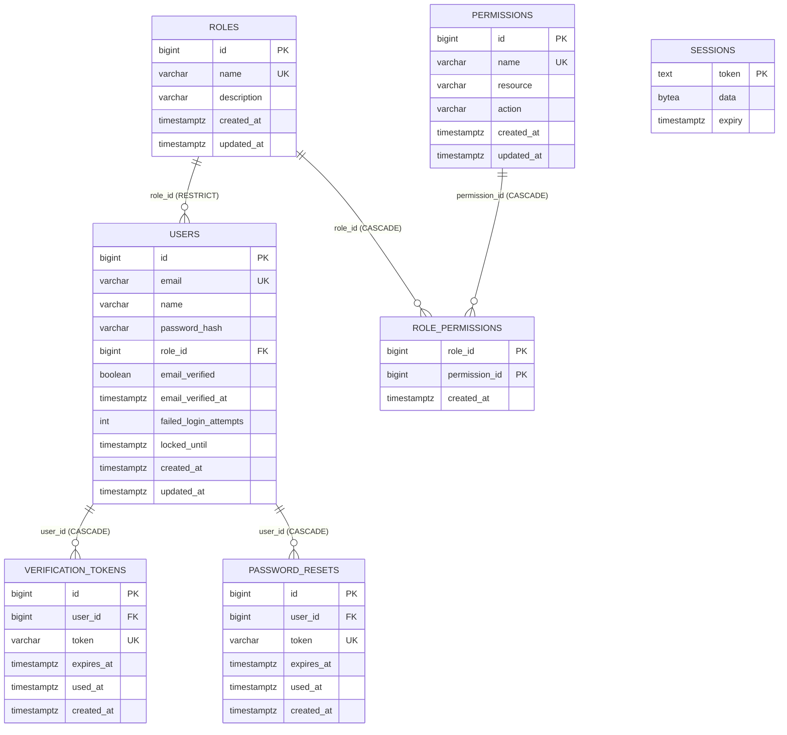
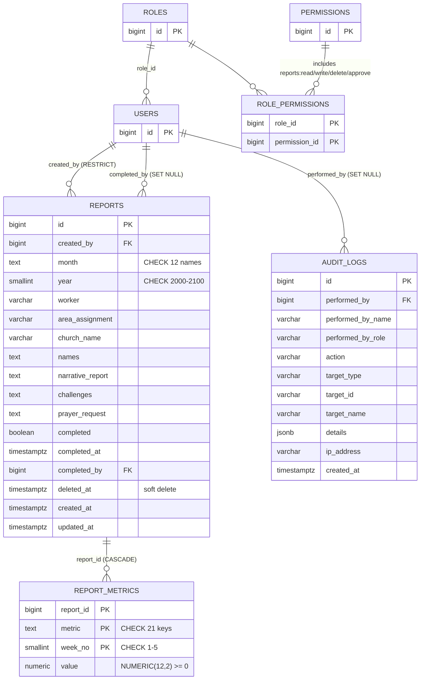

# Backend Schema
## Pastoral Reports Backend

**Version:** 1.0
**Date:** 2026-10-11
**Status:** Part 1 Reference (Existing), Part 2 Proposed (Not Implemented)
**Repository:** github.com/ssr0016/pastoral-reports/backend
**Commit Reference:** f40e94c

> **Purpose:** Part 1 documents the EXISTING PostgreSQL schema and Go models (as of commit f40e94c).
> Part 2 PROPOSES the Reports schema for future Go implementation, based on the Express/MongoDB reference.
> Migration files and Go code are NOT created here — this is the specification.
> Improvements and fixes are tracked in `06-Implementation-Plan.md`.

> **Reading notes.**
> - Part 1 was read from `internal/database/migrations/*.sql`, `internal/model/*.go`, `internal/repository/*.go` and `internal/database/seed.go`.
> - SQL, Go and Squirrel snippets in Parts 2 to 5 are **specification text inside this document**. No `.sql` or `.go` file was created or changed.
> - The owner-approved decisions (section 2.1) are applied as given. Where a decision leaves a gap, the gap is listed in Part 7 instead of being decided silently.

---

## Table of Contents

- [Part 1: Current Schema](#part-1-current-schema-existing)
- [Part 2: Proposed Reports Schema](#part-2-proposed-reports-schema)
- [Part 3: Go Structs](#part-3-go-structs-proposed)
- [Part 4: Migration Plan](#part-4-migration-plan-proposed)
- [Part 5: Squirrel Query Examples](#part-5-squirrel-query-examples-proposed)
- [Part 6: ER Diagrams](#part-6-er-diagrams)
- [Part 7: Open Questions](#part-7-open-questions)
- [Appendix](#appendix)

---

# Part 1: Current Schema (Existing)

## 1.1 Overview

The current backend has 7 tables, all created via goose migrations embedded in the binary:

| Table | Purpose | Migration |
|-------|---------|-----------|
| users | User accounts | 20250101000001 (+ 20250918130003, 20250919140000, 20250919160000) |
| sessions | Session storage (scs) | 20250101000002 |
| roles | RBAC roles | 20250918130000 |
| permissions | RBAC permissions | 20250918130001 |
| role_permissions | Role-permission mapping | 20250918130002 |
| verification_tokens | Email verification | 20250919140000 |
| password_resets | Password reset tokens | 20250919150000 |

Conventions (from migrations):
- `id BIGSERIAL PRIMARY KEY` for all entity tables (`sessions` uses `token TEXT`, `role_permissions` uses a composite key)
- `created_at`, `updated_at TIMESTAMPTZ NOT NULL DEFAULT NOW()` on entity tables
- Foreign keys: `<entity>_id BIGINT REFERENCES <table>(id)`
- ON DELETE: CASCADE for token tables and `role_permissions`, RESTRICT for `users.role_id`
- Index naming: `idx_<table>_<column>` (exception: `sessions_expiry_idx`)
- String columns use `VARCHAR(n)` with explicit lengths; no `TEXT` except `sessions.token`
- No DB triggers for `updated_at`; Go code sets it (`updated_at = NOW()` in updates)
- Seeds are idempotent Go code (`seed.go`), run at every start; one role row (`user`) is inserted by a migration

> **Correction to the pre-filled template.** The task template showed `email`, `name` and `password_hash` as `TEXT`. The migrations define them as `VARCHAR(255)`, `VARCHAR(100)` and `VARCHAR(255)`. The tables below follow the code.

## 1.2 Table: users

Source: `20250101000001_create_users.sql` plus later ALTERs.

```sql
-- Final shape after all migrations:
CREATE TABLE users (
    id                    BIGSERIAL    PRIMARY KEY,
    email                 VARCHAR(255) UNIQUE NOT NULL,
    name                  VARCHAR(100) NOT NULL,
    password_hash         VARCHAR(255) NOT NULL,
    role_id               BIGINT       NOT NULL,                       -- added 20250918130003
    email_verified        BOOLEAN      NOT NULL DEFAULT FALSE,          -- added 20250919140000
    email_verified_at     TIMESTAMPTZ,                                  -- added 20250919140000
    failed_login_attempts INT          NOT NULL DEFAULT 0,              -- added 20250919160000
    locked_until          TIMESTAMPTZ,                                  -- added 20250919160000
    created_at            TIMESTAMPTZ  NOT NULL DEFAULT NOW(),
    updated_at            TIMESTAMPTZ  NOT NULL DEFAULT NOW(),
    CONSTRAINT fk_users_role FOREIGN KEY (role_id) REFERENCES roles(id) ON DELETE RESTRICT
);
CREATE INDEX idx_users_email        ON users(email);          -- redundant with the UNIQUE index
CREATE INDEX idx_users_role_id      ON users(role_id);
CREATE INDEX idx_users_locked_until ON users(locked_until);
```

| Column | Type | Null | Default | Notes |
|---|---|---|---|---|
| id | BIGSERIAL | no | sequence | PK |
| email | VARCHAR(255) | no | | UNIQUE; login identifier |
| name | VARCHAR(100) | no | | Validated 2 to 100 in the API |
| password_hash | VARCHAR(255) | no | | bcrypt; never serialised (`json:"-"`) |
| role_id | BIGINT | no | | FK `fk_users_role`, RESTRICT; backfilled to role `user` in migration 4 |
| email_verified | BOOLEAN | no | FALSE | Not enforced at login |
| email_verified_at | TIMESTAMPTZ | yes | | |
| failed_login_attempts | INT | no | 0 | Reset only by a successful login |
| locked_until | TIMESTAMPTZ | yes | | Lock expiry; set after 5 failures for 15 minutes |
| created_at | TIMESTAMPTZ | no | NOW() | |
| updated_at | TIMESTAMPTZ | no | NOW() | Set by Go on updates |

## 1.3 Table: sessions

Source: `20250101000002_create_sessions.sql`. Owned by the `scs/pgxstore` library (it reads and writes these columns directly).

```sql
CREATE TABLE IF NOT EXISTS sessions (
    token  TEXT        PRIMARY KEY,
    data   BYTEA       NOT NULL,
    expiry TIMESTAMPTZ NOT NULL
);
CREATE INDEX sessions_expiry_idx ON sessions (expiry);
```

| Column | Type | Notes |
|---|---|---|
| token | TEXT PK | Opaque session ID (cookie value) |
| data | BYTEA | Serialised session values (contains `user_id`) |
| expiry | TIMESTAMPTZ | Used for expiry cleanup |

No foreign key to `users`; the user ID lives inside the serialised `data`, so sessions cannot be queried or revoked per user with SQL.

## 1.4 Table: roles

Source: `20250918130000_create_roles.sql`.

```sql
CREATE TABLE roles (
    id          BIGSERIAL    PRIMARY KEY,
    name        VARCHAR(50)  UNIQUE NOT NULL,
    description VARCHAR(255) NOT NULL DEFAULT '',
    created_at  TIMESTAMPTZ  NOT NULL DEFAULT NOW(),
    updated_at  TIMESTAMPTZ  NOT NULL DEFAULT NOW()
);
CREATE INDEX idx_roles_name ON roles(name);   -- redundant with the UNIQUE index
```

## 1.5 Table: permissions

Source: `20250918130001_create_permissions.sql`.

```sql
CREATE TABLE permissions (
    id         BIGSERIAL    PRIMARY KEY,
    name       VARCHAR(100) UNIQUE NOT NULL,
    resource   VARCHAR(50)  NOT NULL,
    action     VARCHAR(50)  NOT NULL,
    created_at TIMESTAMPTZ  NOT NULL DEFAULT NOW(),
    updated_at TIMESTAMPTZ  NOT NULL DEFAULT NOW()
);
CREATE INDEX idx_permissions_name     ON permissions(name);       -- redundant with UNIQUE
CREATE INDEX idx_permissions_resource ON permissions(resource);
```

`name` follows `resource:action` by convention in seed data; the database does not enforce that `name` equals `resource || ':' || action`, and there is no unique constraint on `(resource, action)`.

## 1.6 Table: role_permissions

Source: `20250918130002_create_role_permissions.sql`.

```sql
CREATE TABLE role_permissions (
    role_id       BIGINT      NOT NULL REFERENCES roles(id)       ON DELETE CASCADE,
    permission_id BIGINT      NOT NULL REFERENCES permissions(id) ON DELETE CASCADE,
    created_at    TIMESTAMPTZ NOT NULL DEFAULT NOW(),
    PRIMARY KEY (role_id, permission_id)
);
CREATE INDEX idx_role_permissions_role       ON role_permissions(role_id);        -- covered by the PK
CREATE INDEX idx_role_permissions_permission ON role_permissions(permission_id);
```

## 1.7 Table: verification_tokens

Source: `20250919140000_add_email_verification.sql`.

```sql
CREATE TABLE verification_tokens (
    id         BIGSERIAL    PRIMARY KEY,
    user_id    BIGINT       NOT NULL REFERENCES users(id) ON DELETE CASCADE,
    token      VARCHAR(255) UNIQUE NOT NULL,
    expires_at TIMESTAMPTZ  NOT NULL,
    used_at    TIMESTAMPTZ,
    created_at TIMESTAMPTZ  NOT NULL DEFAULT NOW()
);
CREATE INDEX idx_verification_tokens_token      ON verification_tokens(token);       -- redundant with UNIQUE
CREATE INDEX idx_verification_tokens_user_id    ON verification_tokens(user_id);
CREATE INDEX idx_verification_tokens_expires_at ON verification_tokens(expires_at);
```

Token value: 32 random bytes, base64 URL-encoded (`crypto/rand`), stored **in plaintext**. Lifetime 24 hours (`repository.TokenLifetime`). No `updated_at` column.

## 1.8 Table: password_resets

Source: `20250919150000_create_password_resets.sql`.

```sql
CREATE TABLE password_resets (
    id         BIGSERIAL    PRIMARY KEY,
    user_id    BIGINT       NOT NULL REFERENCES users(id) ON DELETE CASCADE,
    token      VARCHAR(255) UNIQUE NOT NULL,
    expires_at TIMESTAMPTZ  NOT NULL,
    used_at    TIMESTAMPTZ,
    created_at TIMESTAMPTZ  NOT NULL DEFAULT NOW()
);
CREATE INDEX idx_password_resets_token      ON password_resets(token);       -- redundant with UNIQUE
CREATE INDEX idx_password_resets_user_id    ON password_resets(user_id);
CREATE INDEX idx_password_resets_expires_at ON password_resets(expires_at);
```

Same token format as verification tokens. Lifetime 1 hour (`repository.PasswordResetLifetime`).

## 1.9 Relationships and Delete Behaviour

| Child | Parent | Column | ON DELETE |
|---|---|---|---|
| users | roles | role_id | RESTRICT (a role in use cannot be deleted) |
| role_permissions | roles | role_id | CASCADE |
| role_permissions | permissions | permission_id | CASCADE |
| verification_tokens | users | user_id | CASCADE |
| password_resets | users | user_id | CASCADE |
| sessions | (none) | | n/a |

## 1.10 Seed Data (`internal/database/seed.go`, run on every start)

**Roles** (`ON CONFLICT (name) DO NOTHING`): `admin`, `editor`, `user`. Migration 4 inserts `user` first with description "Default user role", so that row keeps the migration's description.

**Permissions (9)**: `users:read`, `users:write`, `users:delete`, `roles:read`, `roles:write`, `roles:delete`, `permissions:read`, `permissions:write`, `permissions:delete` (each with `resource` and `action` split).

**Role to permission mapping**

| Role | Permissions | How assigned |
|---|---|---|
| admin | all permissions in the table | `SELECT ... FROM roles r, permissions p WHERE r.name = 'admin'` (automatically includes any permission added later) |
| editor | `users:read`, `users:write` | hardcoded `p.name IN (...)` |
| user | `users:read` | hardcoded `p.name = 'users:read'` |

**Admin user**: created only when `ADMIN_EMAIL` and `ADMIN_PASSWORD` are set; role `admin`, `email_verified = TRUE`.

## 1.11 Go Models to Tables

| Go type | File | Table | Notes |
|---|---|---|---|
| `model.User` | `model/user.go` | users | `Role *Role` loaded on demand; `PasswordHash`, `FailedLoginAttempts` hidden from JSON |
| `model.UserResponse` | `model/user.go` | (DTO) | omits `locked_until`, `updated_at` |
| `model.Role` | `model/role.go` | roles | `Permissions []Permission` loaded on demand |
| `model.Permission` | `model/role.go` | permissions | |
| `model.RolePermission` | `model/role.go` | role_permissions | |
| `model.VerificationToken` | `model/verification_token.go` | verification_tokens | `IsValid()` |
| `model.PasswordReset` | `model/password_reset.go` | password_resets | `IsValid()` |
| (library) | scs/pgxstore | sessions | no Go model |

All entity structs use `json` and `db` tags; scanning is done manually with `Scan(...)` (the `db` tags are not used by a mapper).

## 1.12 Repository Interfaces (data access surface)

From `internal/repository/interfaces.go`:

| Interface | Methods |
|---|---|
| `UserRepository` | `GetByID`, `GetByEmail`, `CreateWithPassword`, `List`, `ListWithPagination`, `MarkEmailVerified`, `UpdatePassword`, `RecordFailedLogin`, `ResetLoginAttempts`, `UpdateRole`, `GetWithRole` |
| `RoleRepository` | `Create`, `GetByID`, `GetByName`, `List`, `ListWithPagination`, `Update`, `Delete`, `GetPermissions`, `AssignPermission`, `RevokePermission` |
| `PermissionRepository` | `Create`, `GetByID`, `GetByName`, `List`, `ListWithPagination`, `ListByResource`, `Delete` |
| `VerificationRepository` | `Create`, `GetByToken`, `MarkUsed`, `DeleteExpired` |
| `PasswordResetRepository` | `Create`, `GetByToken`, `MarkUsed`, `DeleteExpired` |

`DeleteExpired` exists on both token repositories but nothing schedules it, so expired tokens accumulate.

## 1.13 Observations on the Existing Schema (listed, not fixed)

| # | Observation |
|---|---|
| 1 | Several indexes duplicate the index created by a `UNIQUE` constraint (`idx_users_email`, `idx_roles_name`, `idx_permissions_name`, `idx_verification_tokens_token`, `idx_password_resets_token`) and `idx_role_permissions_role` duplicates the composite PK prefix |
| 2 | Verification and reset tokens are stored in plaintext (not hashed) |
| 3 | `permissions` has no unique `(resource, action)` and no check that `name = resource:action` |
| 4 | `sessions` has no link to `users`; per-user revocation is not possible in SQL |
| 5 | No `updated_at` trigger; `updated_at` is correct only if every Go update statement sets it (token tables have no `updated_at`) |
| 6 | `users.role_id` is `NOT NULL` with `RESTRICT`, so a role with users cannot be deleted (a failed delete currently surfaces as HTTP 500) |
| 7 | Expired token rows are never purged (`DeleteExpired` is unscheduled) |
| 8 | Migration 7 contains an `UPDATE users ... WHERE email = 'admin@example.com'` that only matters for databases seeded by the old default admin |
| 9 | Mixed English/Tagalog comments in migrations 4 and 7 |
| 10 | No audit table and no soft-delete columns anywhere |

---

# Part 2: Proposed Reports Schema

> **Partially implemented: Phase 1 (migrations and seed permissions) landed in 2de41a4.** The migrations are the source of truth for the schema in this Part. Repository, service, handler and Go code for reports do not exist yet.

## 2.1 Overview and Owner-Approved Decisions

New tables: `reports`, `report_metrics`, and (carried over from Document 2, see section 2.5) `audit_logs`. **No existing table is altered.**

| # | Decision | Applied as |
|---|---|---|
| 1 | Metrics storage: child table | `report_metrics(report_id, metric, week_no, value)`, PK `(report_id, metric, week_no)`; `metric` VARCHAR(50) with CHECK in 21 keys; `week_no` SMALLINT CHECK 1..5; `value` NUMERIC(12,2) CHECK >= 0 |
| 2 | Month format: English name | `reports.month VARCHAR(9) NOT NULL` CHECK in 12 names |
| 3 | Metric value type | `NUMERIC(12,2)` for **all** metrics (counts and currency) |
| 4 | Delete strategy: soft delete | `reports.deleted_at TIMESTAMPTZ`; partial indexes `WHERE deleted_at IS NULL`; every query filters soft-deleted rows |
| 5 | Approval metadata | `reports.completed_at TIMESTAMPTZ`, `reports.completed_by BIGINT REFERENCES users(id) ON DELETE SET NULL` |
| 6 | Editor role | Permission-based access: seven `reports:*` permissions (`read`, `read_any`, `write`, `write_any`, `delete`, `delete_any`, `approve`); no hardcoded role behaviour (section 2.8; D-1, D-2) |
| 7 | Duplicate prevention | `CREATE UNIQUE INDEX idx_reports_unique_per_user ON reports(created_by, month, year) WHERE deleted_at IS NULL`; SQLSTATE 23505 maps to 409 `CONFLICT` |

## 2.2 Table: reports

```sql
CREATE TABLE reports (
    id               BIGSERIAL    PRIMARY KEY,
    created_by       BIGINT       NOT NULL REFERENCES users(id) ON DELETE RESTRICT,
    month            VARCHAR(9)   NOT NULL,
    year             SMALLINT     NOT NULL,
    worker           VARCHAR(150),
    area_assignment  VARCHAR(150),
    church_name      VARCHAR(150),
    names            TEXT,
    narrative_report TEXT,
    challenges       TEXT,
    prayer_request   TEXT,
    completed        BOOLEAN      NOT NULL DEFAULT FALSE,
    completed_at     TIMESTAMPTZ,
    completed_by     BIGINT       REFERENCES users(id) ON DELETE SET NULL,
    deleted_at       TIMESTAMPTZ,
    created_at       TIMESTAMPTZ  NOT NULL DEFAULT NOW(),
    updated_at       TIMESTAMPTZ  NOT NULL DEFAULT NOW(),

    CONSTRAINT chk_reports_month CHECK (month IN (
        'January','February','March','April','May','June',
        'July','August','September','October','November','December')),
    CONSTRAINT chk_reports_year CHECK (year BETWEEN 2000 AND 2100),
    CONSTRAINT chk_reports_completed CHECK (
        (completed AND completed_at IS NOT NULL) OR (NOT completed AND completed_at IS NULL)),
    CONSTRAINT chk_reports_text_len CHECK (
        char_length(names)            <= 5000  AND
        char_length(narrative_report) <= 10000 AND
        char_length(challenges)       <= 10000 AND
        char_length(prayer_request)   <= 10000)
);
```

| Column | Type | Null | Default | Rule / Source |
|---|---|---|---|---|
| id | BIGSERIAL | no | seq | PK (convention) |
| created_by | BIGINT | no | | FK users, **RESTRICT** (not decided by the owner; see Part 7). Set by the server from the session, never by the client |
| month | VARCHAR(9) | no | | Decision 2; CHECK in 12 English names (exact casing) |
| year | SMALLINT | no | | Express default "current year" is applied by the service; DB range 2000 to 2100 (tighter bound in the service) |
| worker | VARCHAR(150) | yes | | Express optional; limit from Document 2 |
| area_assignment | VARCHAR(150) | yes | | Express `areaAssignment` |
| church_name | VARCHAR(150) | yes | | Express `churchName` |
| names | TEXT | yes | | Express `names`; max 5000 (Document 2) |
| narrative_report | TEXT | yes | | max 10000 |
| challenges | TEXT | yes | | max 10000 |
| prayer_request | TEXT | yes | | max 10000 |
| completed | BOOLEAN | no | FALSE | Express `completed` |
| completed_at | TIMESTAMPTZ | yes | | Decision 5; set when approved, cleared when unapproved |
| completed_by | BIGINT | yes | | Decision 5; FK users, SET NULL |
| deleted_at | TIMESTAMPTZ | yes | | Decision 4; NULL means active |
| created_at | TIMESTAMPTZ | no | NOW() | |
| updated_at | TIMESTAMPTZ | no | NOW() | Set by Go on every update (existing convention; no trigger) |

NULL behaviour: a `CHECK` on a NULL column evaluates to unknown and passes, so optional text columns can stay NULL. The service should decide whether an empty string is stored as `''` or NULL (Part 7).

## 2.3 Table: report_metrics

```sql
CREATE TABLE report_metrics (
    report_id BIGINT        NOT NULL REFERENCES reports(id) ON DELETE CASCADE,
    metric    VARCHAR(50)   NOT NULL,
    week_no   SMALLINT      NOT NULL,
    value     NUMERIC(12,2) NOT NULL,
    PRIMARY KEY (report_id, metric, week_no),

    CONSTRAINT chk_report_metrics_metric CHECK (metric IN (
        'worship_service','sunday_school','prayer_meeting','bible_studies',
        'mens_fellowship','womens_fellowship','youth_fellowship','children_fellowship',
        'tithes_offering','home_visited','bible_study_group_led','sermon_preached',
        'person_newly_contacted','person_followed_up','person_evangelized','outreach',
        'training','leadership','baptism','other','family_day')),
    CONSTRAINT chk_report_metrics_week  CHECK (week_no BETWEEN 1 AND 5),
    CONSTRAINT chk_report_metrics_value CHECK (value >= 0)
);
```

| Column | Type | Rule |
|---|---|---|
| report_id | BIGINT | FK reports; CASCADE only matters for a hard delete (soft delete leaves metric rows in place) |
| metric | VARCHAR(50) | One of the 21 keys (section 2.4) |
| week_no | SMALLINT | 1 to 5 (Express `week1` to `week5`) |
| value | NUMERIC(12,2) | >= 0; range 0 to 9,999,999,999.99 |

Design notes:
- **Sparse storage (proposal):** a row exists only for a (metric, week) that was supplied. A missing row means "not reported"; `0.00` means "reported zero". Maximum 105 rows per report (21 x 5).
- The table intentionally has **no** `created_at`/`updated_at` (the owner specified four columns); the parent `reports.updated_at` reflects edits. Rows are replaced as a set on update.
- Because `metric` is constrained by CHECK, **adding a new metric requires a migration** that replaces `chk_report_metrics_metric`. (Document 2 listed "no migration for a new metric" as a pro of the child-table option; that holds only without the CHECK.)

## 2.4 Metric Key Catalog (21)

| # | Key (stored value) | Express field |
|---|---|---|
| 1 | worship_service | worshipService |
| 2 | sunday_school | sundaySchool |
| 3 | prayer_meeting | prayerMeeting |
| 4 | bible_studies | bibleStudies |
| 5 | mens_fellowship | mensFellowship |
| 6 | womens_fellowship | womensFellowship |
| 7 | youth_fellowship | youthFellowship |
| 8 | children_fellowship | childrenFellowship |
| 9 | tithes_offering | tithesOffering (monetary; the reason for NUMERIC(12,2)) |
| 10 | home_visited | homeVisited |
| 11 | bible_study_group_led | bibleStudyGroupLed |
| 12 | sermon_preached | sermonPreached |
| 13 | person_newly_contacted | personNewlyContacted |
| 14 | person_followed_up | personFollowedUp |
| 15 | person_evangelized | personEvangelized |
| 16 | outreach | outreach |
| 17 | training | training |
| 18 | leadership | leadership |
| 19 | baptism | baptism |
| 20 | other | other |
| 21 | family_day | familyDay |

Stored keys are snake_case (D-6). The legacy frontend and Excel templates need a camelCase to snake_case mapping for metric names only; `week1..week5` is unchanged.

## 2.5 Table: audit_logs (carried over from Document 2)

Not one of the seven owner decisions. It is included because Documents 1 and 2 require audit logging for report actions, and it is confirmed (D-10, `07-Reports-Decisions.md`).

```sql
CREATE TABLE audit_logs (
    id                BIGSERIAL    PRIMARY KEY,
    performed_by      BIGINT       REFERENCES users(id) ON DELETE SET NULL,
    performed_by_name VARCHAR(100),
    performed_by_role VARCHAR(50),
    action            VARCHAR(50)  NOT NULL,
    target_type       VARCHAR(50)  NOT NULL,
    target_id         VARCHAR(64),
    target_name       VARCHAR(255),
    details           JSONB        NOT NULL DEFAULT '{}'::jsonb,
    ip_address        VARCHAR(64),
    created_at        TIMESTAMPTZ  NOT NULL DEFAULT NOW(),

    CONSTRAINT chk_audit_logs_action CHECK (action IN (
        'CREATE_REPORT','UPDATE_REPORT','DELETE_REPORT',
        'APPROVE_REPORT','UNAPPROVE_REPORT',
        'DOWNLOAD_SINGLE_EXCEL','DOWNLOAD_BULK_EXCEL'))
);
```

Actor name and role are stored as a snapshot so the log remains meaningful if the user or role changes. `details` holds `{month, year, count}`; narrative text and prayer requests must not be stored there.

The table is append-only for the server: the migration runs `REVOKE UPDATE, DELETE ON audit_logs FROM app_user`, because the default privileges grant DML on new tables. Deleting an audited user still works, since the `SET NULL` action runs with the table owner's rights.

## 2.6 Indexes

| Index | Definition | Purpose |
|---|---|---|
| `idx_reports_unique_per_user` | `UNIQUE ON reports(created_by, month, year) WHERE deleted_at IS NULL` | Decision 7: atomic duplicate prevention; also serves "my reports" lookups (leading column `created_by`) |
| `idx_reports_year_created_at` | `ON reports(year DESC, created_at DESC) WHERE deleted_at IS NULL` | Default list ordering (Express sorted `year` desc, `createdAt` desc) |
| `idx_reports_year_month` | `ON reports(year, month) WHERE deleted_at IS NULL` | Equality filters and per-period summaries |
| `idx_audit_logs_created_at` | `ON audit_logs(created_at DESC)` | Recent activity |
| `idx_audit_logs_target` | `ON audit_logs(target_type, target_id)` | History of one record |
| `idx_audit_logs_action` | `ON audit_logs(action)` | Filter by action |
| (primary key of `report_metrics`) | `(report_id, metric, week_no)` | Fetch all metrics of a report; no extra index needed |

Notes:
- All `reports` indexes are **partial** (`WHERE deleted_at IS NULL`), which only helps queries that include the same predicate; every report query must include `deleted_at IS NULL` (section 2.7).
- Express filtered with case-insensitive regex (`$regex`, `i`). A btree index cannot serve a `%text%` pattern, so church/area/worker have no index (D-11: partial `ILIKE` match, no `pg_trgm`).
- A separate `idx_reports_created_by` is not proposed because the unique index already has `created_by` as its leading column.

## 2.7 Integrity Rules and Soft-Delete Semantics

| Rule | Mechanism |
|---|---|
| One active report per user, month, year | Partial unique index (decision 7). SQLSTATE `23505` on constraint `idx_reports_unique_per_user` maps to HTTP 409 `CONFLICT` |
| Recreate after delete | Allowed: a soft-deleted row is outside the partial index |
| Month is an English name | `chk_reports_month` |
| Metric key, week and value valid | `chk_report_metrics_*` |
| Approval fields consistent | `chk_reports_completed` (`completed` iff `completed_at` is set); `completed_by` may be NULL (user removed or never recorded) |
| Soft delete | `UPDATE reports SET deleted_at = NOW(), updated_at = NOW() WHERE id = $1 AND deleted_at IS NULL` |
| Reads exclude deleted rows | **Every** query on `reports` includes `deleted_at IS NULL`; metrics are always reached through a non-deleted report (join or `report_id IN (<ids already filtered>)`) |
| Restore (if ever offered) | `SET deleted_at = NULL`; fails with 23505 if an active report for the same user/month/year exists |
| `updated_at` | Set in Go on every UPDATE (no trigger, per existing convention) |
| User deletion | `created_by` is RESTRICT; the application has no user-delete feature today |

No database view or row-level security is proposed; the soft-delete filter is an application-level rule.

## 2.8 Permissions and the Editor Role (Decision 6)

**Principle (owner decision):** access is permission-based. Role names are not hardcoded in report handlers.

New rows for the existing `permissions` table (convention `resource:action`):

| name | resource | action | Meaning |
|---|---|---|---|
| `reports:read` | reports | read | List and view own reports |
| `reports:write` | reports | write | Create reports and update own reports |
| `reports:delete` | reports | delete | Soft-delete own reports |
| `reports:read_any` | reports | read_any | List and view any user's reports |
| `reports:write_any` | reports | write_any | Update any user's report |
| `reports:delete_any` | reports | delete_any | Soft-delete any user's report |
| `reports:approve` | reports | approve | Approve / unapprove (`completed`) and record approver. Global: no `_any` variant |

Existing mechanism: `middleware.RequirePermission(roleRepo, userRepo, sm, perms...)` requires **all** listed permissions and is implemented but currently unused. It reads permissions from `role_permissions` on each request; **no schema change is needed** for it.

Role assignment (how seed data behaves today):
- `admin` receives every permission automatically (the seed uses a cross join), so all seven new permissions reach admin as soon as they are added to the seed list.
- `editor` and `user` assignments are **hardcoded lists** in `seed.go`. Phase 1 (2de41a4) extended both (D-2). Seeds only insert, so changing defaults later does not revoke rows already in production.

Default assignments (D-2):
- `user`: `reports:read`, `reports:write`, `reports:delete` (own reports only).
- `editor`: all seven.
- `admin`: all seven, through the cross join.

| Capability | Permission needed | admin | editor | user |
|---|---|:---:|:---:|:---:|
| List / view own reports | `reports:read` | yes | yes | yes |
| List / view any report | `reports:read_any` | yes | yes | no |
| Create own report | `reports:write` | yes | yes | yes |
| Update own report | `reports:write` + ownership | yes | yes | yes |
| Update any report | `reports:write_any` | yes | yes | no |
| Delete own report | `reports:delete` + ownership | yes | yes | yes |
| Delete any report | `reports:delete_any` | yes | yes | no |
| Approve / unapprove | `reports:approve` | yes | yes | no |

**Resolved (D-1):** the `_any` variants express scope, so no role is hardcoded. Another user's report returns **404**, not 403, on get, update and delete. `approve` is global: it works on any report by ID, and a custom role with `approve` but without `read_any` cannot list reports. The schema does not change (only the permission rows differ).

Ownership itself is checked in the service by comparing `reports.created_by` to the session user; it is not a database constraint.

## 2.9 MongoDB to PostgreSQL Mapping

| Express (Mongoose) | PostgreSQL | Notes |
|---|---|---|
| `_id` ObjectId | `reports.id BIGSERIAL` | New numeric IDs; legacy ObjectIds are not preserved unless a mapping column is added (Part 7) |
| `month` String (required) | `reports.month VARCHAR(9)` + CHECK | Express had no validation; now an enum of names |
| `year` Number (required, default current year) | `reports.year SMALLINT` | Default applied in the service |
| `worker` | `reports.worker VARCHAR(150)` | |
| `areaAssignment` | `reports.area_assignment VARCHAR(150)` | |
| `churchName` | `reports.church_name VARCHAR(150)` | |
| `<metric>.week1..week5` (21 objects) | `report_metrics(metric, week_no, value)` rows | `weekN` becomes `week_no = N`; Number becomes `NUMERIC(12,2)` |
| `names` | `reports.names TEXT` | |
| `narrativeReport` | `reports.narrative_report TEXT` | |
| `challenges` | `reports.challenges TEXT` | |
| `prayerRequest` | `reports.prayer_request TEXT` | |
| `createdBy` ObjectId (optional) | `reports.created_by BIGINT NOT NULL` | Now required |
| `completed` Boolean | `reports.completed BOOLEAN` | Plus `completed_at`, `completed_by` |
| `createdAt` / `updatedAt` | `created_at` / `updated_at` | |
| (hard delete) | `reports.deleted_at` soft delete | Decision 4 |
| `AuditLog` collection (not in the report analysis) | `audit_logs` | Fields from `logAction`: user, action, targetType, targetId, targetName, details, ipAddress |

## 2.10 Size and Performance Notes

- Up to 105 `report_metrics` rows per report. 1,000 reports is at most about 105,000 rows; a few thousand reports per year is well within a single PostgreSQL instance.
- Reading one report is two indexed queries (report by `id`, metrics by `report_id` through the PK).
- Listing a page needs one query for the page of reports and one `report_id IN (...)` query for their metrics (no N+1).
- Summaries (totals per metric by church, area or month) are `GROUP BY` queries over `report_metrics` joined to `reports`; the child-table design makes these straightforward.
- `NUMERIC` arithmetic is exact; sums of `value` carry two decimals with no floating-point drift.

---

# Part 3: Go Structs (Proposed)

> **Specification only.** These are not created in the repository. They follow the existing conventions in `internal/model` (`json` + `db` tags, `XxxResponse`, `ToResponse()`, `XxxRequest` with `validate` tags).

## 3.1 Entities

```go
// Report maps to the reports table.
type Report struct {
    ID              int64      `json:"id" db:"id"`
    CreatedBy       int64      `json:"created_by" db:"created_by"`
    Month           string     `json:"month" db:"month"`
    Year            int16      `json:"year" db:"year"`
    Worker          *string    `json:"worker,omitempty" db:"worker"`
    AreaAssignment  *string    `json:"area_assignment,omitempty" db:"area_assignment"`
    ChurchName      *string    `json:"church_name,omitempty" db:"church_name"`
    Names           *string    `json:"names,omitempty" db:"names"`
    NarrativeReport *string    `json:"narrative_report,omitempty" db:"narrative_report"`
    Challenges      *string    `json:"challenges,omitempty" db:"challenges"`
    PrayerRequest   *string    `json:"prayer_request,omitempty" db:"prayer_request"`
    Completed       bool       `json:"completed" db:"completed"`
    CompletedAt     *time.Time `json:"completed_at,omitempty" db:"completed_at"`
    CompletedBy     *int64     `json:"completed_by,omitempty" db:"completed_by"`
    DeletedAt       *time.Time `json:"-" db:"deleted_at"`
    CreatedAt       time.Time  `json:"created_at" db:"created_at"`
    UpdatedAt       time.Time  `json:"updated_at" db:"updated_at"`

    // Metrics is loaded on demand (not a column).
    Metrics map[string]map[int]pgtype.Numeric `json:"-"`
}

// ReportMetric maps to the report_metrics table.
type ReportMetric struct {
    ReportID int64          `db:"report_id"`
    Metric   string         `db:"metric"`
    WeekNo   int16          `db:"week_no"`
    Value    pgtype.Numeric `db:"value"`
}

// AuditLog maps to the audit_logs table.
type AuditLog struct {
    ID              int64             `db:"id"`
    PerformedBy     *int64            `db:"performed_by"`
    PerformedByName *string           `db:"performed_by_name"`
    PerformedByRole *string           `db:"performed_by_role"`
    Action          string            `db:"action"`
    TargetType      string            `db:"target_type"`
    TargetID        *string           `db:"target_id"`
    TargetName      *string           `db:"target_name"`
    Details         map[string]any    `db:"details"`
    IPAddress       *string           `db:"ip_address"`
    CreatedAt       time.Time         `db:"created_at"`
}
```

Numeric type: `pgtype.Numeric` comes from `github.com/jackc/pgx/v5/pgtype`, which is already a dependency (pgx v5.11.0). No decimal library exists in `go.mod`, and none is proposed here. JSON representation of values is open (Part 7).

## 3.2 Request and Response DTOs

```go
// MetricWeeks holds the five weekly values of one metric (Express: week1..week5).
// Absent weeks are omitted; present values must be >= 0.
type MetricWeeks struct {
    Week1 *json.Number `json:"week1,omitempty" validate:"omitempty,gte=0"`
    Week2 *json.Number `json:"week2,omitempty" validate:"omitempty,gte=0"`
    Week3 *json.Number `json:"week3,omitempty" validate:"omitempty,gte=0"`
    Week4 *json.Number `json:"week4,omitempty" validate:"omitempty,gte=0"`
    Week5 *json.Number `json:"week5,omitempty" validate:"omitempty,gte=0"`
}

// CreateReportRequest / UpdateReportRequest share fields; created_by and
// completed are never accepted from the client.
type CreateReportRequest struct {
    Month           string                 `json:"month" validate:"required,oneof=January February March April May June July August September October November December"`
    Year            *int                   `json:"year" validate:"omitempty,gte=2000,lte=2100"`
    Worker          string                 `json:"worker" validate:"max=150"`
    AreaAssignment  string                 `json:"area_assignment" validate:"max=150"`
    ChurchName      string                 `json:"church_name" validate:"max=150"`
    Names           string                 `json:"names" validate:"max=5000"`
    NarrativeReport string                 `json:"narrative_report" validate:"max=10000"`
    Challenges      string                 `json:"challenges" validate:"max=10000"`
    PrayerRequest   string                 `json:"prayer_request" validate:"max=10000"`
    Metrics         map[string]MetricWeeks `json:"metrics" validate:"dive,keys,oneof=worshipService sundaySchool prayerMeeting bibleStudies mensFellowship womensFellowship youthFellowship childrenFellowship tithesOffering homeVisited bibleStudyGroupLed sermonPreached personNewlyContacted personFollowedUp personEvangelized outreach training leadership baptism other familyDay,endkeys"`
}

// ReportResponse is the API representation (bare object, per existing convention).
type ReportResponse struct {
    ID              int64                   `json:"id"`
    CreatedBy       int64                   `json:"created_by"`
    Month           string                  `json:"month"`
    Year            int                     `json:"year"`
    Worker          string                  `json:"worker,omitempty"`
    AreaAssignment  string                  `json:"area_assignment,omitempty"`
    ChurchName      string                  `json:"church_name,omitempty"`
    Metrics         map[string]MetricWeeks  `json:"metrics"`
    Names           string                  `json:"names,omitempty"`
    NarrativeReport string                  `json:"narrative_report,omitempty"`
    Challenges      string                  `json:"challenges,omitempty"`
    PrayerRequest   string                  `json:"prayer_request,omitempty"`
    Completed       bool                    `json:"completed"`
    CompletedAt     *time.Time              `json:"completed_at,omitempty"`
    CompletedBy     *int64                  `json:"completed_by,omitempty"`
    CreatedAt       time.Time               `json:"created_at"`
    UpdatedAt       time.Time               `json:"updated_at"`
}

// ListReportsParams are the query filters (page/limit via pkg/pagination).
type ListReportsParams struct {
    Month  string // optional
    Year   int    // optional, 0 = any
    Worker string
    Area   string
    Church string
}
```

Response shape: the nested `metrics` object mirrors Express (`{"worshipService": {"week1": 120, "week2": 98}}`), assembled from `report_metrics` rows. List responses use the existing `pagination.Response[ReportResponse]`.

## 3.3 Repository Interface (specification)

Following `internal/repository/interfaces.go` naming and the `(nil, nil)` not-found convention:

```go
type ReportRepository interface {
    Create(ctx context.Context, userID int64, req model.CreateReportRequest) (*model.Report, error)
    GetByID(ctx context.Context, id int64) (*model.Report, error)                  // nil, nil if missing or soft-deleted
    ListWithPagination(ctx context.Context, p model.ListReportsParams, page, limit int) ([]model.Report, int64, error)
    Update(ctx context.Context, id int64, req model.UpdateReportRequest) (*model.Report, error)
    SoftDelete(ctx context.Context, id int64) (bool, error)
    ToggleComplete(ctx context.Context, id, approverID int64) (*model.Report, error)
}

type AuditRepository interface {
    Create(ctx context.Context, e model.AuditLog) error   // used inside the same transaction as the change
}
```

Transactions: the existing code has no transaction helper (Document 4, section 19). Create, update, delete and approve each need one transaction (report + metrics + audit); how it is exposed is an implementation decision (Part 7).

---

# Part 4: Migration Plan (Proposed)

> Phase 1 migrations 1 to 3 exist (2de41a4) and are the source of truth; the seed changes in 4.2 are done. Names follow `YYYYMMDDHHMMSS_<description>.sql` with goose `Up`/`Down` and `StatementBegin/End`.

## 4.1 Proposed Migrations (in order)

| # | File (proposed) | Up | Down |
|---|---|---|---|
| 1 | `<ts>_create_reports.sql` | `CREATE TABLE reports` (section 2.2) with constraints; `idx_reports_unique_per_user`, `idx_reports_year_created_at`, `idx_reports_year_month` (no church/area/worker indexes, D-11) | `DROP TABLE IF EXISTS reports` (indexes drop with it) |
| 2 | `<ts>_create_report_metrics.sql` | `CREATE TABLE report_metrics` (section 2.3) | `DROP TABLE IF EXISTS report_metrics` |
| 3 | `<ts>_create_audit_logs.sql` | `CREATE TABLE audit_logs` + 3 indexes (pending confirmation) | `DROP TABLE IF EXISTS audit_logs` |

Down order is the reverse of Up (`audit_logs`, `report_metrics`, `reports`); `report_metrics` must be dropped before `reports`.

## 4.2 Seed Changes (not a migration)

Per existing convention, permissions and role assignments live in `internal/database/seed.go`, not in migrations:
1. Add the seven `reports:*` permissions to the permission list (admin receives them automatically).
2. Add the agreed `editor` and `user` assignments (D-2, section 2.8) to the hardcoded assignment statements.

Seeding is idempotent (`ON CONFLICT DO NOTHING`), so it is safe on existing databases.

## 4.3 Rollout Order

1. Run migrations 1 to 3 against the target database (on Railway this runs automatically as `preDeployCommand: /app/api migrate`; `make migrate-up` is the manual route).
2. Deploy the application version that contains the seed changes and reports code.
3. Verify: tables and constraints present; `permissions` contains the seven new rows; admin has them.

Existing tables are untouched, so migrations are additive and the previous application version keeps working against the new schema.

## 4.4 Rollback

`goose down` three steps (or one at a time). Dropping `reports` removes report data permanently. Permission rows inserted by seed remain after a schema rollback and must be removed manually if the feature is withdrawn.

## 4.5 Legacy Data (out of scope here)

Importing data from MongoDB is not designed in this document. It would need: a user mapping (Express users to Go users, likely by email), month normalisation, week-field flattening to `report_metrics`, and a decision on whether to keep legacy ObjectIds (Part 7).

---

# Part 5: Squirrel Query Examples (Proposed)

> Specification only. They follow the existing repository style: `r.db.Builder` (`$n` placeholders), `ToSql()`, `r.db.Pool`, and wrapped errors. pgx transactions come from `r.db.Pool.Begin(ctx)`.

## 5.1 Create (transaction: report, metrics, audit)

```go
tx, err := r.db.Pool.Begin(ctx)
if err != nil { return nil, fmt.Errorf("begin: %w", err) }
defer func() { _ = tx.Rollback(ctx) }()

q, args, _ := r.db.Builder.
    Insert("reports").
    Columns("created_by", "month", "year", "worker", "area_assignment", "church_name",
        "names", "narrative_report", "challenges", "prayer_request").
    Values(userID, req.Month, year, nullable(req.Worker), nullable(req.AreaAssignment), nullable(req.ChurchName),
        nullable(req.Names), nullable(req.NarrativeReport), nullable(req.Challenges), nullable(req.PrayerRequest)).
    Suffix("RETURNING id, created_at, updated_at").
    ToSql()

var rep model.Report
if err := tx.QueryRow(ctx, q, args...).Scan(&rep.ID, &rep.CreatedAt, &rep.UpdatedAt); err != nil {
    var pgErr *pgconn.PgError
    if errors.As(err, &pgErr) && pgErr.Code == "23505" &&
        pgErr.ConstraintName == "idx_reports_unique_per_user" {
        return nil, ErrDuplicateReport // handler maps to apperror.Conflict(...)
    }
    return nil, fmt.Errorf("insert report: %w", err)
}

// one multi-row insert for all supplied (metric, week) values
ib := r.db.Builder.Insert("report_metrics").Columns("report_id", "metric", "week_no", "value")
for metric, weeks := range req.Metrics {
    for weekNo, v := range weeks.NonNil() { // weekNo 1..5, v decimal text
        ib = ib.Values(rep.ID, metric, weekNo, v)
    }
}
// only execute when at least one value exists
```

## 5.2 Get One (excludes soft-deleted)

```go
q, args, _ := r.db.Builder.
    Select(reportColumns).
    From("reports").
    Where(sq.Eq{"id": id, "deleted_at": nil}).   // deleted_at IS NULL
    ToSql()
// pgx.ErrNoRows -> return nil, nil

mq, margs, _ := r.db.Builder.
    Select("metric", "week_no", "value").
    From("report_metrics").
    Where(sq.Eq{"report_id": id}).
    ToSql()
```

## 5.3 List with Filters and Pagination

```go
func escapeLike(s string) string {
    return strings.NewReplacer(`\`, `\\`, `%`, `\%`, `_`, `\_`).Replace(s)
}

where := sq.And{sq.Eq{"r.deleted_at": nil}}
if p.Year != 0     { where = append(where, sq.Eq{"r.year": p.Year}) }
if p.Month != ""   { where = append(where, sq.Expr("lower(r.month) = lower(?)", p.Month)) }
if p.Worker != ""  { where = append(where, sq.ILike{"r.worker": "%" + escapeLike(p.Worker) + "%"}) }
if p.Area != ""    { where = append(where, sq.ILike{"r.area_assignment": "%" + escapeLike(p.Area) + "%"}) }
if p.Church != ""  { where = append(where, sq.ILike{"r.church_name": "%" + escapeLike(p.Church) + "%"}) }

countQ, countArgs, _ := r.db.Builder.Select("COUNT(*)").From("reports r").Where(where).ToSql()

listQ, listArgs, _ := r.db.Builder.
    Select(reportColumnsWithAlias("r")).
    From("reports r").
    Where(where).
    OrderBy("r.year DESC", "r.created_at DESC", "r.id DESC").
    Limit(uint64(limit)).   // #nosec G115 - limit validated
    Offset(uint64(offset)). // #nosec G115 - offset validated
    ToSql()

// then, for the IDs on this page only (no N+1):
mq, margs, _ := r.db.Builder.
    Select("report_id", "metric", "week_no", "value").
    From("report_metrics").
    Where(sq.Eq{"report_id": ids}).   // slice becomes IN ($1,$2,...)
    ToSql()
```

`ILIKE` filters keep Express's "partial, case-insensitive" behaviour but with wildcards escaped (Express passed raw regex). The final semantics are Part 7, question 11 (decided in D-11).

## 5.4 Update (transaction: scalars, replace metrics, audit)

```go
q, args, _ := r.db.Builder.
    Update("reports").
    SetMap(map[string]any{
        "month": req.Month, "year": year, "worker": nullable(req.Worker),
        "area_assignment": nullable(req.AreaAssignment), "church_name": nullable(req.ChurchName),
        "names": nullable(req.Names), "narrative_report": nullable(req.NarrativeReport),
        "challenges": nullable(req.Challenges), "prayer_request": nullable(req.PrayerRequest),
    }).
    Set("updated_at", sq.Expr("NOW()")).
    Where(sq.Eq{"id": id, "deleted_at": nil}).
    Suffix("RETURNING " + reportColumns).
    ToSql()
// 0 rows -> not found; 23505 -> 409 (changing month/year can collide)

delQ, delArgs, _ := r.db.Builder.Delete("report_metrics").Where(sq.Eq{"report_id": id}).ToSql()
// then the multi-row insert from 5.1
```

`created_by` and `completed*` are not in the SET list: they cannot change through update.

## 5.5 Soft Delete

```go
q, args, _ := r.db.Builder.
    Update("reports").
    Set("deleted_at", sq.Expr("NOW()")).
    Set("updated_at", sq.Expr("NOW()")).
    Where(sq.Eq{"id": id, "deleted_at": nil}).
    ToSql()
res, err := tx.Exec(ctx, q, args...)
// res.RowsAffected() == 0 -> 404 (also fixes the existing "delete missing row -> 500" pattern for reports)
```

## 5.6 Toggle Complete (single atomic statement)

In PostgreSQL the right-hand side of `SET` sees the row's old values, so one statement flips the flag and the metadata consistently:

```go
q, args, _ := r.db.Builder.
    Update("reports").
    Set("completed", sq.Expr("NOT completed")).
    Set("completed_at", sq.Expr("CASE WHEN completed THEN NULL ELSE NOW() END")).
    Set("completed_by", sq.Expr("CASE WHEN completed THEN NULL ELSE ?::bigint END", approverID)).
    Set("updated_at", sq.Expr("NOW()")).
    Where(sq.Eq{"id": id, "deleted_at": nil}).
    Suffix("RETURNING " + reportColumns).
    ToSql()
```

The returned `completed` value determines whether the audit action is `APPROVE_REPORT` or `UNAPPROVE_REPORT`.

## 5.7 Audit Insert (same transaction)

```go
q, args, _ := r.db.Builder.
    Insert("audit_logs").
    Columns("performed_by", "performed_by_name", "performed_by_role", "action",
        "target_type", "target_id", "target_name", "details", "ip_address").
    Values(actor.ID, actor.Name, actor.RoleName, "APPROVE_REPORT",
        "Report", strconv.FormatInt(id, 10), targetName, detailsJSON, ip).
    ToSql()
_, err = tx.Exec(ctx, q, args...)
```

## 5.8 Ownership Check and Summary Examples

```go
// Ownership (service layer compares created_by with the session user)
q, args, _ := r.db.Builder.Select("created_by").From("reports").
    Where(sq.Eq{"id": id, "deleted_at": nil}).ToSql()

// Totals per metric for a church and year
q, args, _ := r.db.Builder.
    Select("m.metric", "SUM(m.value) AS total").
    From("report_metrics m").
    Join("reports r ON r.id = m.report_id").
    Where(sq.And{sq.Eq{"r.deleted_at": nil}, sq.Eq{"r.year": year}, sq.Eq{"r.church_name": church}}).
    GroupBy("m.metric").
    OrderBy("m.metric").
    ToSql()
```

---

# Part 6: ER Diagrams

## 6.1 Current Schema



## 6.2 Proposed Schema (new tables highlighted by name)



(`AUDIT_LOGS.target_id` is a logical reference to `reports.id` stored as text; it is not a foreign key so audit history survives report removal.)

## 6.3 Soft Delete and Duplicate Rule

```mermaid
stateDiagram-v2
    [*] --> Active: INSERT (unique per user, month, year among active rows)
    Active --> Completed: toggle complete (completed_at, completed_by set)
    Completed --> Active: toggle again (cleared)
    Active --> Deleted: soft delete (deleted_at = now)
    Completed --> Deleted: soft delete
    Deleted --> Active: restore (only if no active duplicate; not specified)
    Deleted --> [*]: purge (not specified)
```



---

# Part 7: Open Questions

> **Status:** D-1..D-11 and D-14 are decided in `07-Reports-Decisions.md`. Phase 1 is implemented in 2de41a4. Still open: D-12, D-13, D-15, D-16, D-17 (see the plan, section 13). The questions below are kept as originally written and are not rewritten.

| # | Question | Why it matters |
|---|---|---|
| 1 | **Ownership scope.** How is "own" vs "any report" expressed with the four permissions (add `reports:write_any`/`reports:delete_any`, or define another rule)? | Without it, admin override cannot be expressed without hardcoding a role, contradicting Decision 6 |
| 2 | Which of `reports:read/write/delete/approve` do `editor` and `user` hold by default? | Required to edit `seed.go`; currently TBD |
| 3 | `created_by` delete behaviour (proposed RESTRICT) and user-deletion policy | The app has no user-delete feature; RESTRICT blocks deleting any user who authored a report |
| 4 | JSON representation of `NUMERIC(12,2)`: number (`1234.50`) or string (`"1234.50"`), and Go type (`pgtype.Numeric`, `json.Number`, or string) | Affects exactness at the client and Excel export; no decimal library is in `go.mod` |
| 5 | Absent vs zero: should a missing (metric, week) be "not reported" (sparse rows, proposed) or always stored as `0.00`? | Changes row counts, aggregation and reporting semantics |
| 6 | Metric keys: keep Express camelCase (proposed) or snake_case? Is a migration acceptable whenever a metric is added (CHECK constraint)? | Compatibility with legacy frontend and Excel; maintenance cost |
| 7 | Length limits (150 / 5,000 / 10,000) and year range (2000-2100) are proposals from Document 2; are they acceptable? | The Express backend had no limits |
| 8 | Are `worker`, `area_assignment`, `church_name` required, and should churches/areas become lookup tables? | Express had them optional free text; normalisation affects filters and reports |
| 9 | Soft-delete lifecycle: restore endpoint, admin "trash" listing, retention and purge? | Restoring can hit the unique index; deleted narratives remain stored |
| 10 | Confirm `audit_logs` (not in the owner's seven decisions): include, column set, `ip_address` as text vs `INET`, retention period, readable via API? | Documents 1 and 2 require audit logging; table is proposed here only |
| 11 | Filter semantics: partial case-insensitive match (as Express) or equality/prefix? Is a trigram index acceptable? | Determines whether the church/area/worker btree indexes help; no trigram extension is configured |
| 12 | Is `week_no` 5 always allowed, or should it be validated against the number of weeks in the month? | Express accepted any `week1..week5` |
| 13 | Should empty strings be stored as NULL? | Affects `omitempty` output and filters |
| 14 | How are transactions exposed in repositories (helper, unit-of-work)? | Document 4: no transaction convention exists yet |
| 15 | Legacy data import: needed? user mapping, keep ObjectIds in a `legacy_id` column? | Not designed here |
| 16 | Should report permissions also gate `GET /users` and other endpoints already unprotected by permission? | Out of schema scope, but part of adopting `RequirePermission` |
| 17 | Should seeded `editor`/`user` assignments move from hardcoded lists to a data-driven table? | Existing seed is hardcoded per role |

---

# Appendix

## A. Constraint and Index Catalog (Proposed)

| Object | Kind | Definition |
|---|---|---|
| `chk_reports_month` | CHECK | month in 12 English names |
| `chk_reports_year` | CHECK | year between 2000 and 2100 |
| `chk_reports_completed` | CHECK | `completed` iff `completed_at` is set |
| `chk_reports_text_len` | CHECK | names <= 5000; narrative, challenges, prayer request <= 10000 |
| `idx_reports_unique_per_user` | UNIQUE partial index | `(created_by, month, year) WHERE deleted_at IS NULL` |
| `idx_reports_year_created_at` | partial index | `(year DESC, created_at DESC) WHERE deleted_at IS NULL` |
| `idx_reports_year_month` | partial index | `(year, month) WHERE deleted_at IS NULL` |
| `chk_report_metrics_metric` | CHECK | metric in 21 keys |
| `chk_report_metrics_week` | CHECK | week_no between 1 and 5 |
| `chk_report_metrics_value` | CHECK | value >= 0 |
| `report_metrics` PK | PRIMARY KEY | `(report_id, metric, week_no)` |
| `chk_audit_logs_action` | CHECK | action in 7 values |
| `idx_audit_logs_created_at` | index | `(created_at DESC)` |
| `idx_audit_logs_target` | index | `(target_type, target_id)` |
| `idx_audit_logs_action` | index | `(action)` |

## B. HTTP Mapping of Database Errors (Proposed)

| Database condition | Detection | HTTP |
|---|---|---|
| Duplicate active report | SQLSTATE `23505`, constraint `idx_reports_unique_per_user` | 409 `CONFLICT` |
| CHECK violation (month, week, value, length) | SQLSTATE `23514` (should not occur if API validation passes) | 422 `VALIDATION_ERROR` or 500 if it escapes validation |
| Foreign key violation | SQLSTATE `23503` | 400 or 409 depending on case |
| No row updated or deleted | `RowsAffected() == 0` | 404 `NOT_FOUND` |

## C. Glossary

| Term | Meaning |
|---|---|
| Soft delete | Marking a row as deleted (`deleted_at`) instead of removing it |
| Partial index | Index that covers only rows matching a `WHERE` predicate |
| SQLSTATE 23505 | PostgreSQL unique-violation error code |
| NUMERIC(12,2) | Exact decimal with up to 12 digits, 2 after the decimal point |
| Sparse storage | Storing only supplied values; absent means "not reported" |
| Child table | Table whose rows belong to a parent row via a foreign key |
| pgtype.Numeric | pgx v5 type for PostgreSQL `NUMERIC` |
| Squirrel | SQL builder used by the repositories |
| goose | Migration tool |
| RBAC | Role-Based Access Control |

## D. References

- `docs/00-Repository-Analysis.md`, `docs/01-PRD.md`, `docs/02-App-Flow.md`, `docs/03-Tech-Stack.md`, `docs/04-Content-Guidelines.md`
- `docs/reference/report-analysis.docx` (Express/MongoDB reference)
- `internal/database/migrations/*.sql`, `internal/database/seed.go`
- `internal/model/{user,role,password_reset,verification_token}.go`
- `internal/repository/interfaces.go`
- `06-Implementation-Plan.md` (to be created)
