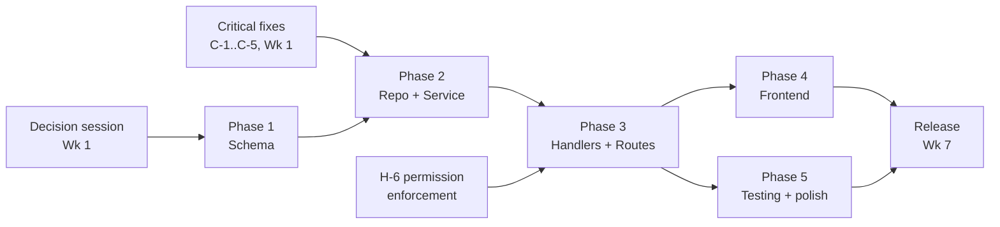

# Implementation Plan
## Pastoral Reports Backend

**Version:** 1.0
**Date:** 2026-10-11
**Status:** Planning Document
**Repository:** github.com/ssr0016/pastoral-reports/backend
**Commit Reference:** f40e94c (application code unchanged since; later commits are documentation only)
**Target Audience:** Development team, project owner

> **Purpose.** This plan consolidates the findings from Documents 00-05 into a
> phased roadmap for implementing the Reports feature and fixing the issues
> identified during documentation.

> **How this plan was built.** Every finding in Document 03 section 20 (18 gaps) and Document 04 section 18 (25 inconsistencies) is mapped to a work item in the traceability tables of Appendix 14.1, so nothing was dropped. Items that appear in more than one source were **merged** (not counted twice), and the totals are reconciled in section 12.1. Estimates are effort-hours for one engineer, taken from the requested outline unless marked **(added)**. Deviations from the outline are listed in Appendix 14.4.

---

## Table of Contents

1. [Executive Summary](#1-executive-summary)
2. [Current State Recap](#2-current-state-recap)
3. [Reports Feature Implementation Plan](#3-reports-feature-implementation-plan)
4. [Existing Bugs & Fixes (from Doc 04)](#4-existing-bugs--fixes)
5. [Technical Debt & Infrastructure (from Doc 03)](#5-technical-debt--infrastructure)
6. [Testing Strategy](#6-testing-strategy)
7. [Security Hardening](#7-security-hardening)
8. [Deployment Strategy](#8-deployment-strategy)
9. [Risk Register](#9-risk-register)
10. [Team & Responsibilities](#10-team--responsibilities)
11. [Success Metrics](#11-success-metrics)
12. [Timeline & Milestones](#12-timeline--milestones)
13. [Open Questions Blocking Implementation](#13-open-questions-blocking-implementation)
14. [Appendix](#14-appendix)

---

## 1. Executive Summary

The backend today is a working authentication and access-management foundation: registration, login with server-side sessions, CSRF protection, email-verification and password-reset token flows, account lockout, role and permission management, health/metrics/Swagger endpoints, a Docker image and a CI pipeline. It builds, its unit and integration tests pass, and a 43-check live API test run against a real server passed (42 of 43; the one failure was a wrong expected status in the test script). What it does **not** contain is the product itself: there is no pastoral-report entity, endpoint, table or permission, and no audit logging.

This plan covers three streams of work that run in a deliberate order: (1) a short stream of **critical corrections** (monitoring that records wrong status codes, a plaintext token in the logs, wrong status on delete, missing rate limits) that should land before anything new is built; (2) the **Reports feature** across five phases (schema, repository and service, handlers and routes, frontend integration, testing), estimated at about 73 hours of backend effort plus frontend work that is not estimated; and (3) a **hardening and debt stream** (security gaps, infrastructure, response-format consistency, test coverage) that is scheduled around the feature.

Total planned effort is **about 244 hours** of backend work, **about 317 hours** with the 30% buffer recommended in the risk register, which is roughly 12 calendar weeks at 25 to 30 productive hours per week for one engineer. Seventeen design questions from Document 05 must be answered first; seven of them block the first migration. A decision session in Week 1 is the single most important dependency of this plan.

---

## 2. Current State Recap

### 2.1 What Exists (Working)

| Feature | Status | Source |
|---|---|---|
| Registration, login, logout, `GET /auth/me` | Implemented, verified live | Doc 01 FR-AUTH-01/02/05; Doc 02 sec. 3 |
| Sessions in PostgreSQL (cookie, 24 h, 30 min idle hardcoded) | Implemented; idle env var ignored | Doc 02 sec. 4; Doc 03 sec. 6 |
| CSRF double-submit + `GET /auth/csrf` | Implemented, verified live | Doc 02 sec. 3.1 |
| Password strength (entropy >= 60), bcrypt cost 10 | Implemented | Doc 03 sec. 6 |
| Account lockout (5 attempts, 15 min) | Implemented; relocks after expiry | Doc 02 sec. 3.5 |
| Email verification | **Partial**: token logic works, no email delivery, not enforced at login | Doc 01 FR-AUTH-11 |
| Password reset | **Partial**: token logic works, no email delivery | Doc 01 FR-AUTH-12 |
| RBAC data model, role/permission/assignment admin APIs | Implemented (admin-only routes) | Doc 01 FR-RBAC-01..07 |
| User management | **Partial**: list/get, admin role change; no create/update/delete/profile | Doc 01 sec. 5.3 |
| Rate limiting on register and login | Implemented (in memory, per IP) | Doc 03 sec. 12 |
| Prometheus metrics, `/health`, `/ready`, `/live` | Implemented; status label wrong for app errors, DB gauges unused | Doc 03 sec. 10 |
| Swagger / OpenAPI | Implemented; some annotations inaccurate | Doc 04 sec. 14 |
| Seed (roles, permissions, optional env admin) | Implemented | Doc 05 sec. 1.10 |
| Docker image, compose (dev, prod), GitHub Actions (lint, test, frontend, build, gosec) | Implemented | Doc 03 sec. 15-16 |
| Monorepo with `backend/` and a Next.js scaffold in `frontend/` | Exists; frontend has no integration | Doc 01 sec. 4.4 |

### 2.2 What is Missing

| Feature | Gap | Impact |
|---|---|---|
| Reports feature (entire) | No schema, API, permissions or UI | The product goal is not met |
| Audit logging | No audit table or writes; only stdout request logs | No accountability for approvals, deletes, downloads |
| Rate limiting on forgot/reset/verify | Not applied | Brute force and enumeration pressure |
| Email delivery | No mail client or provider | Verification and reset cannot be used by real users |
| Test coverage | service ~30%, handlers/middleware/repositories mostly 0% | Regressions in auth/RBAC go unnoticed |
| Production migration automation | Automatic on Railway: Pre-deploy Command `/app/api migrate`, set in the Railway UI (c594f36; see [ARCHITECTURE](../../docs/ARCHITECTURE.md)) | A failed migration fails the deploy; no advisory lock yet for several instances |
| Permission-based authorization | `RequirePermission` unused; `editor` role has no effect | RBAC model gives a false sense of protection |
| Session revocation | Not on password reset, lock, role change | Stolen/old sessions survive credential changes |
| Dependency vulnerability scanning, CD pipeline | None | Unknown CVE exposure; manual releases |
| Infrastructure fixes | Pool tuning, exposed Postgres port, old base images, public swagger/metrics | Operational and security risk |

### 2.3 Known Issues Summary

Counted from this plan's master backlog (section 12.1, Appendix 14.1). Each work item is counted once under its main category.

| Category | Items | Hours | Work items |
|---|---:|---:|---|
| Security | 15 | 37 | C-3, C-5, M-9, H-1, H-2, H-3, H-4, H-6, L-3, S-1, I-4, I-5, I-6, I-7, I-8 |
| Correctness | 9 | 22 | C-1, C-2, C-4, H-5, H-7, M-2, M-8, F-2, L-5 |
| Performance / operations | 8 | 23 | I-1, I-2, I-3, I-9, I-10, I-11, I-12, I-13 |
| Documentation / consistency | 14 | 31 | M-1, M-3, M-4, M-5, M-6, M-7, M-10, L-1, L-2, L-4, L-6, L-7, L-8, L-9 |
| Feature gaps (not defects) | 3 | 14 | E-1, F-1, F-3 |
| Test coverage | 4 | 44 | T-1..T-4 |
| **Subtotal (existing system)** | **53** | **171** | |
| Reports feature | 5 phases | 73 | Section 3 |
| **Total** | | **244** | |

Each work item is counted once under its main category (an item that spans two categories, such as H-3, is listed where its main impact is).

---

## 3. Reports Feature Implementation Plan

### 3.1 Overview

Five phases:

| Phase | Name | Target |
|---|---|---|
| 1 | Schema & Migrations | Week 2 |
| 2 | Repository & Service | Weeks 3-4 |
| 3 | Handlers & Routes | Weeks 4-5 |
| 4 | Frontend Integration | Weeks 5-6 (parallel) |
| 5 | Testing & Polish | Week 6 |

The detailed schema, queries and Go types are specified in `05-Backend-Schema.md` (Parts 2 to 5); the flows and authorization matrix in `02-App-Flow.md` (Part 2). This section sequences that work.

**Prerequisites before Phase 1:** decisions D-1 to D-8 in section 13 (they fix the CHECK constraints, foreign key behaviour and index set), a fresh database backup, and the critical fixes C-1 and C-2 so the rollout is observable.

### 3.2 Phase 1: Schema & Migrations

**Tasks**

| Task | File | Estimate |
|------|------|----------|
| Create migration `create_reports` | `internal/database/migrations/2026..._create_reports.sql` | 2h |
| Create migration `create_report_metrics` | `internal/database/migrations/2026..._create_report_metrics.sql` | 2h |
| Create migration `create_audit_logs` | `internal/database/migrations/2026..._create_audit_logs.sql` | 2h |
| Update seed with reports permissions | `internal/database/seed.go` | 1h |
| Test migrations up/down | manual | 1h |
| **Total Phase 1** | | **8h (1 day)** |

**Deliverables**
- 3 migration files
- Updated `seed.go`
- Migrations tested locally

**Acceptance Criteria**
- `make migrate-up` succeeds
- `make migrate-down` succeeds
- Re-running up after down works
- Permissions seeded (seven `reports:*`: `read`, `read_any`, `write`, `write_any`, `delete`, `delete_any`, `approve`; admin holds all seven; `user` and `editor` per D-2)

**Notes:** `audit_logs` is included (D-10 decided). Existing tables are not altered, so the previous application version keeps working against the new schema.

### 3.3 Phase 2: Repository & Service

**Tasks**

| Task | File | Estimate |
|------|------|----------|
| Create model structs | `internal/model/report.go` | 4h |
| Create model constants | `internal/model/report_constants.go` | 1h |
| Create audit model | `internal/model/audit_log.go` | 2h |
| Create report repository interface | `internal/repository/interfaces.go` | 1h |
| Create report repository implementation | `internal/repository/report_repo.go` | 8h |
| Create audit repository | `internal/repository/audit_repo.go` | 4h |
| Add transaction helper | `internal/repository/helpers.go` | 2h |
| Create report service | `internal/service/report_service.go` | 8h |
| Create audit service | `internal/service/audit_service.go` | 2h |
| **Total Phase 2** | | **32h (4 days)** |

**Acceptance Criteria**
- Unit tests for service (70%+)
- Integration tests for repository (testcontainers, `integration` tag)
- All transactions tested (create, update, soft delete, approve each commit and roll back together with their audit row)

**Notes**
- A `MockReportRepo` in the style of `MockUserRepo` is needed for service tests (include in the repository task).
- The transaction helper is also the first one in the codebase (Doc 04 sec. 19); its shape is Shape A (D-14), and only the new report and audit repositories take the querier; existing repositories are not retrofitted.
- The service enforces ownership rules chosen in D-1/D-2 and the soft-delete filter rule from Doc 05 section 2.7.

### 3.4 Phase 3: Handlers & Routes

**Tasks**

| Task | File | Estimate |
|------|------|----------|
| Create report handler | `internal/handler/report_handler.go` | 8h |
| Register routes | `internal/router/router.go` | 2h |
| Add Swagger annotations | handlers | 2h |
| Add permissions to routes (`RequirePermission`) | `internal/middleware`, `router.go` | 1h |
| **Total Phase 3** | | **13h (about 2 days)** |

**Endpoints (6):** `GET/POST /api/v1/reports`, `GET/PUT/DELETE /api/v1/reports/:id`, `PATCH /api/v1/reports/:id/complete`. `POST /api/v1/reports/log-download` is dropped (D-10, Option 2); details in Doc 02 sec. 13.

**Acceptance Criteria**
- All endpoints documented in Swagger
- `make swagger` regenerates correctly
- Manual API testing passes (the live test script, extended with the reports cases, is the checklist)

**Notes:** New handlers follow the conventions in Doc 04 (bare DTO responses, `{data, meta}` for lists, `apperror` mapping, 409 on SQLSTATE 23505). D-9 is decided: today's convention is kept, so no envelope change precedes this phase. No audit handler (D-10: no read API). The 1h permission task assumes H-6 has already produced the permission-checking pattern.

### 3.5 Phase 4: Frontend Integration

The `frontend/` directory is an unmodified Next.js scaffold (no pages for login, reports or admin; no API client). **Frontend effort is not estimated here**; it needs its own plan.

| Task | Owner |
|---|---|
| Provide API contract: Swagger link, example payloads, error codes | Backend |
| Provide the CSRF flow (`GET /auth/csrf`, `credentials: "include"`, `X-CSRF-Token`) | Backend |
| Agree the JSON form of `NUMERIC` values and metric key casing (D-4, D-6) | Backend + Frontend |
| Build login, report form (21 metrics x 5 weeks), list with filters, approval UI, Excel export | Frontend |
| Support integration testing; fix contract defects | Both |
| **Total Phase 4** | **depends on frontend** |

### 3.6 Phase 5: Testing & Polish

| Task | Estimate |
|------|----------|
| Unit tests for handlers | 4h |
| Integration tests end-to-end | 4h |
| Load testing (optional) | 4h |
| Bug fixes from testing | 4h |
| Documentation update | 2h |
| **Total Phase 5** | **18h (2 days)** |

### 3.7 Total Estimate

| Phase | Estimate |
|-------|----------|
| Phase 1 | 8h |
| Phase 2 | 32h |
| Phase 3 | 13h |
| Phase 4 | dependent |
| Phase 5 | 18h |
| **Total (without Phase 4)** | **~73h (9-10 days)** |

---

## 4. Existing Bugs & Fixes

Consolidated from Document 04 section 18 (25 inconsistencies), with items from Documents 01 to 03 where they affect the same code. Work-item IDs are stable and used throughout this plan. **Every one of the 25 Doc 04 items maps to a work item (Appendix 14.1).**

### 4.1 Critical (Fix Immediately)

| ID | Bug | File | Impact | Fix Estimate |
|----|-----|------|--------|--------------|
| C-1 | Prometheus status label wrong for `AppError` (401/403/422/429 recorded as 200). **Delivered in a5ed763**; the hours are accounting, not remaining work | `middleware/metrics.go` | Blinds monitoring | 2h |
| C-2 | Request logger status wrong for `AppError` (warn branch never reached). **Delivered in a5ed763**; the hours are accounting, not remaining work | `middleware/logger.go` | Blinds logging | 2h |
| C-3 | Verification token logged in plaintext. **Delivered in 355fe7d (verification) and dc7bad0 (reset)**; the hours are accounting, not remaining work | `service/verification_service.go` | Security leak | 1h |
| C-4 | Delete of a missing row returns 500 instead of 404. **Delivered in 30172f4 (404) and f87de24 (409 for a role still held by users)**; the hours are accounting, not remaining work | `repository/helpers.go` + role/permission handlers | Wrong status code | 2h |
| C-5 | No rate limit on forgot-password, reset-password, verify-email. **Delivered in a7621d5, hardened by c756994 (idle eviction), 7e01638 (visitor cap), b2d3cbf (key normalization) and bd167bc (trusted proxy extractor, H-4)**; the hours are accounting, not remaining work | `router.go`, `main.go` | Brute force / enumeration risk | 1h |
| **Total** | | | | **8h** |

Details and "done when":

| ID | Approach | Done when |
|---|---|---|
| C-1 / C-2 | One shared fix: derive the final status from `AppError`/`HTTPError` (or let the error handler run before the status is read). C-1 and C-2 share one root cause; implement together | A 401, 403, 422 and 429 request increments `http_requests_total{status=...}` correctly and logs at `warn` with the right status; unit test with `httptest` |
| C-3 | Remove `token` from the log line (reset token removed in `dc7bad0`, verification token in `355fe7d`; the request logger also redacts the `token` query parameter, `6f7ebcf`) | No token appears in any log at any level; verification still works (see E-1 for how developers obtain tokens afterwards) |
| C-4 | Return a typed "not found" error from `deleteByID` (done as the sentinel `repository.ErrNotFound`, wrapped with `%w`) and map it to `apperror.NotFound` in handlers | `DELETE /admin/roles/:id` and `/admin/permissions/:id` on a missing id return 404 (test added) |
| C-5 | Add the existing `RateLimit` middleware to the three routes (done with a separate bucket per route, burst 3: forgot-password 1 per 10 min, reset-password and verify-email 1 per min; routes moved into `router.Setup`; covered by `TestTokenRoutes_RateLimited` and `TestTokenRoutes_BucketsAreIndependent`, which assert "burst 3, then 429"; the "within a minute" timing is intended behaviour and is not asserted by them, the refill and eviction timing is covered by the `evictAfter` tests) | 4th request within a minute returns 429 on each route |

### 4.2 High Priority (Sprint 1)

| ID | Bug | Impact | Fix Estimate |
|----|-----|--------|--------------|
| H-1 | Sessions not revoked on password reset. **Delivered** (migration `20251012000002_add_user_link_to_sessions.sql`, `session.Store`, `UserRepo.UpdatePassword`); the hours are accounting, not remaining work | Security | 4h |
| H-2 | Sessions not revoked on lock / role change (and on user delete when that exists). **Re-scoped; nothing left to build now**, see the details below | Security | 4h |
| H-3 | Email verification not enforced at login | Correctness | 2h |
| H-4 | `RealIP` trusts forwarded headers (rate limit and audit IP spoofable). **Delivered in bd167bc (trusted proxy extractor), with b56ea20 (`peer_ip` logging) and 01e8c24 (IPv6 keys grouped by /64)**; the hours are accounting, not remaining work | Security | 2h |
| H-5 | No duplicate-name check on role update (surfaces as 500). **Delivered in cb84c20 (409 via the DB unique constraint, race-safe)**; the hours are accounting, not remaining work | Data integrity | 2h |
| H-6 | `RequirePermission` unused; `editor` role has no effect; `/users` open to any authenticated user | Security | 4h |
| H-7 | Validation error is the raw validator string; `details` never populated. **Delivered in 22b6390**; actual effort about 1 to 1.5h, and the hours are accounting, not remaining work | UX | 4h |
| **Total** | | | **22h** |

| ID | Approach and dependencies |
|----|---------------------------|
| H-1, H-2 | **Delivered for H-1.** `sessions` gained `user_id` (FK to `users`, `ON DELETE CASCADE`, indexed) and `revoked_at`. A custom scs store (`internal/session/store.go`, over `pgxstore`) records `user_id` from the session data on every commit and never finds or updates a revoked row. Revocation is a tombstone (`UPDATE ... SET revoked_at`), not a delete: with an idle timeout every request re-commits its session as an upsert, so a request that loaded the session before the revocation would recreate a deleted row. `UserRepo.UpdatePassword` changes the password and revokes the user's sessions in one transaction (a failed revocation rolls the password back). Sessions that existed before the migration have `user_id` NULL and age out within the 24h lifetime. **H-2 re-scoped.** Role change needs no revocation: `RequireRole` and `RequirePermission` load the user and role from the database on every request, so a change applies at once. The lock half is deliberately not implemented: the automatic lockout is triggered by *unauthenticated* failed logins, so revoking sessions on lock would let anyone force a victim out by failing five logins; lockout is a brute-force defence, not a compromise response; and checking `locked_until` in `RequireAuth` would add a database read to every authenticated request. The revocation primitive exists; wire it to an admin disable action and to user deletion (already covered by the FK cascade) when those exist |
| H-3 | **Depends on E-1** (email delivery). Enforcing verification before users can receive the email would lock everyone out. Needs decision D-12 |
| H-4 | Configure Echo's IP extractor with a trusted-proxy setting; new env variable `TRUSTED_PROXY_CIDRS` (default `100.64.0.0/10`, Railway's edge range, from production `peer_ip` data). Done as `TrustedProxyExtractor`: only configured ranges are trusted and `X-Forwarded-For` is never read; verified in production with a spoofed `X-Real-IP` |
| H-5 | Add the conflict check (mirrors `Create`) and map unique violations (done by mapping the unique violation to 409 in the repository and handler, which is race-safe; no pre-check) |
| H-6 | Apply `RequirePermission` to existing routes, starting with `GET /users` and `/users/:id`; establishes the pattern used by Reports Phase 3. Interacts with D-1 and D-2 |
| H-7 | Return per-field `details` (`field` to message) using the already supported `WithDetails`; keep `message` stable. Done in `CustomValidator.Validate`: it maps `validator.ValidationErrors` to per-field `details` keyed by JSON name (one message per field, first failing tag wins), `message` is the constant `"validation failed"`, and `Value()` is never read so a rejected password cannot leak. The 9 handler call sites return the `AppError` directly (re-wrapping `err.Error()` would drop the details) |

### 4.3 Medium Priority (Sprint 2-3)

| ID | Item | Impact | Fix Estimate |
|----|------|--------|--------------|
| M-1 | Response envelope inconsistency (bare object vs `{data, meta}` vs array vs `{message}`). **D-9: keep today's convention; documentation only** | DX | 1h |
| M-2 | `GET /users` documented as paginated but only `limit` works, returns a bare array | Correctness | 4h |
| M-3 | Swagger success types wrong for paginated lists (`{array}` vs `{data, meta}`) | DX | 2h |
| M-4 | Swagger `@Failure` missing on many handlers; middleware errors undocumented | DX | 4h |
| M-5 | Swagger title/description/contact still the template's. **Delivered in 760f265**; the hours are accounting, not remaining work | DX | 1h |
| M-6 | DTO location inconsistent (3 request DTOs live in handler files) | Maintainability | 4h |
| M-7 | Session key constant (`UserIDKey`) not used (`"user_id"` literals) | Maintainability | 1h |
| M-8 | Config loaded but ignored (`DB_*`, `SESSION_IDLE_TIMEOUT`); session reads env directly; align cookie `SameSite` policy | Correctness | 2h |
| M-9 | Rate limiter improvements: per-route buckets, `Retry-After`, configurable limits (remainder of the "only on register/login" finding after C-5). **Partial: `Retry-After` delivered in 9e080e1** (delay-seconds from the limiter's bucket, exposed through CORS); configurable limits (env vars) remain open, so the hours still cover that work | Security | 3h |
| M-10 | Template naming leftovers and stale docs (compose names, README URLs, ROADMAP "COMPLETE", Swagger host). **Delivered in 94edf61 (compose names), e208b3e (README and ROADMAP, CUSTOMIZATION.md removed) and 760f265 (Swagger host)**; the hours are accounting, not remaining work | DX | 2h |
| M-11 | API surface production hardening: `/swagger/*` and `/metrics` were public in production (API map, request counts, latencies, error rates), and `/ready` put the database error in its 503 body. Found during implementation, so **not in the total below**. **Delivered in e3f6b72** (`SWAGGER_ENABLED`; `/metrics` behind Basic Auth or not served in production; generic `/ready`); about 2 to 3h of actual effort | Security | 2-3h |
| **Total** | | | **31h** |

Notes:
- **M-1 would have been a breaking change** for any client; the frontend has no integration yet. D-9 kept today's convention, so M-1 is reduced to documenting it (0 to 1h) and nothing breaks.
- M-2 can be done with the existing `UserRepository.ListWithPagination` and `pagination.FromContext`.
- M-10 also covers ROADMAP.md (states "COMPLETE 100%", lists a Railway URL and "Seed data (3 roles, 9 perms, 1 admin)"), README Railway URLs, SETUP.md container names.

### 4.4 Low Priority (Backlog)

| ID | Item | Impact | Fix Estimate |
|----|------|--------|--------------|
| L-1 | Index naming exception (`sessions_expiry_idx`) | Cosmetic | 1h |
| L-2 | Tagalog comments in migrations and `session.go` | Consistency | 2h |
| L-3 | Reset-password does not apply `strongpass` (done 2026-10-16: `strongpass` on the request plus the 72-byte check in `PasswordResetService`, 422 on `new_password`) | Security | 1h |
| L-4 **(added)** | `err == service.ErrX` vs `errors.Is` in verification/reset handlers (Doc 04 #8) | Maintainability | 1h |
| L-5 **(added)** | `UpdateRoleRequest` cannot distinguish omitted from empty (Doc 04 #14) | Correctness | 2h |
| L-6 **(added)** | Pagination clamping duplicated in repositories (Doc 04 #3) | Maintainability | 2h |
| L-7 **(added)** | Routes registered in both `main.go` and `router.go` (Doc 04 #21) | Maintainability | 1h |
| L-8 **(added)** | Handler dependency field names vary (Doc 04 #16) | Maintainability | 1h |
| L-9 **(added)** | Assign (200 + message) vs revoke (204) response style (Doc 04 #24) | Consistency | 1h |
| **Total** | | | **12h** (4h from the outline + 8h added to close traceability) |

Doc 04 #15 (layering: service layer only for auth/verification/reset) is **not a defect**; it is documented as a rule in `docs/ARCHITECTURE.md` and needs only an ADR if it is to change (0h, tracked in M-10).

### 4.5 Total Bug Fix Estimate

| Priority | Estimate |
|----------|----------|
| Critical | 8h |
| High | 22h |
| Medium | 31h |
| Low | 12h |
| **Grand Total** | **73h (9 days)** |

(The requested outline totalled 66h; the difference is -1h from merging "rate limiting only on register/login" with C-5, and +8h of Doc 04 items that the outline did not list.)

---

## 5. Technical Debt & Infrastructure

Consolidated from Document 03 section 20 (18 gaps), plus items found during implementation (I-13). Mapping of all 18 is in Appendix 14.1; I-13 is not part of that mapping.

### 5.1 Infrastructure Improvements

| ID | Gap | Priority | Estimate |
|----|-----|----------|----------|
| I-1 | Connection pool not configured (`pgxpool.New` defaults) | Medium | 2h |
| I-2 | DB gauges (`db_connections_*`) never updated | Low | 2h |
| I-3 | ~~No migration step in production~~ **Delivered in c594f36**: Railway runs `/app/api migrate` as its Pre-deploy Command (set in the UI); the hours are accounting, not remaining work. Open: advisory lock for several instances | High | 4h |
| I-4 | Prod compose publishes Postgres on the host | High | 1h |
| I-5 | Outdated base images (`postgres:15.3`, `alpine:3.19`) | Medium | 2h |
| I-6 | Swagger and `/metrics` public in all environments | Medium | 2h |
| I-7 | gosec non-blocking (`-no-fail`) and unpinned (`@master`) | Medium | 2h |
| I-8 | No dependency vulnerability scan (govulncheck / Dependabot / image scan) | High | 4h |
| I-9 | No CD pipeline | Medium | 8h |
| I-10 | Unpinned dev tools (`@latest`) and local/CI linter version drift. **Delivered:** Makefile pins in 2c3656b (golangci-lint) and ffb623e (air, swag, goose), SETUP.md and docs updated alongside; the 1h is accounting, not remaining work | Low | 1h |
| I-11 | No HTTP client abstraction for outbound calls | Medium | 4h |
| I-12 | `go mod tidy` needed (indirect markers) | Low | 1h |
| I-13 | Fresh clone has no `.env` (gitignored by design), so `make migrate-*` fails with an opaque connection error (empty `DATABASE_URL`) instead of pointing to SETUP.md step 2. Setup only. **Delivered in 98f4093** (SETUP.md note); the 1h is accounting, not remaining work | Low | 1h |
| **Total** | | | **34h** |

### 5.2 Security Hardening

Security items that are **new** relative to sections 4 and 5.1 (the others are the same work items, referenced in section 7):

| ID | Item | Priority | Estimate |
|----|------|----------|----------|
| S-1 | Hash verification and reset tokens at rest (store a digest, compare on lookup) | High | 4h |

The outline listed six security items totalling 18h; five of them (session revocation on reset, rate limit on all auth endpoints, trusted proxy for `RealIP`, adopt `RequirePermission`, enforce verification at login) are the **same work** as H-1, C-5/M-9, H-4, H-6 and H-3, so they are not counted again. Counting them twice would overstate the plan by 14h.

### 5.3 Items Added from Documents 01 and 02 (not in the outline)

| ID | Item | Source | Estimate |
|----|------|--------|----------|
| E-1 | Email delivery for verification and reset (provider integration, templates, config; a development-only mailer for local use) | Doc 01 FR-AUTH-11/12; PRD open question | 8h (assumption) |
| F-1 | Change-password for logged-in users (done 2026-10-16: `POST /auth/change-password`, UI at `/account/password`; see 07 "F-1") | Doc 01 FR-AUTH-14 | 4h (assumption) |
| F-2 | Reset the lockout counter when the lock expires; optional admin unlock | Doc 02 sec. 3.5 | 2h (assumption) |
| F-3 | Protect against removing the last admin / deleting built-in roles | Doc 01 FR-RBAC-08 | 2h (assumption) |

E-1 is on the critical path for H-3. Estimates marked "assumption" are by analogy and need confirmation once the provider and policies are chosen.

### 5.4 Test Coverage Improvement

| ID | Area | Current | Target | Estimate |
|----|------|---------|--------|----------|
| T-1 | handlers | CSRF handler only | 70% | 16h |
| T-2 | middleware | 0% | 70% | 12h |
| T-3 | repository (unit, with mock/driver) | 0% | 60% | 8h |
| T-4 | service | ~30% | 80% | 8h |
| **Total** | | | | **44h** |

Coverage for **new** Reports code is inside Phases 2, 3 and 5; the table above is for the existing code.

---

## 6. Testing Strategy

### 6.1 Layers

| Layer | Tooling (existing) | Scope | Runs in CI |
|---|---|---|---|
| Unit | `testing`, mock repositories (`MockUserRepo` pattern) | services, validators, config, helpers | Yes |
| HTTP/handler | `httptest.NewRequestWithContext`, real middleware chain, `apperror.ErrorHandler` | handlers, middleware (status mapping, CSRF, rate limit, auth, RBAC) | Yes |
| Integration | build tag `integration`, testcontainers Postgres, `internal/testutil` | repositories, migrations, transactions, unique-index behaviour | **Not yet** (add, I-8/CI task) |
| End-to-end | Live server + database, script covering health, CSRF, register/login, lockout, rate limit, RBAC, reset, verification | whole stack, release smoke test | No (script exists outside the repo) |

### 6.2 Approach

1. **Fix-first tests:** every item in section 4 gets a regression test in the same change (the C-1/C-2 status mapping, the C-4 404, C-5 429s).
2. **Reports:** TDD at the service layer using `MockReportRepo`; repository integration tests assert the schema rules from Doc 05 section 2.7 (duplicate prevention returns 23505, soft-deleted rows invisible, CHECK constraints reject bad month/week/value, approval fields consistent, transaction rollback leaves no partial data).
3. **End-to-end:** commit the live test script (or port it to a Go test using the `integration` tag) and extend it with the report flows: create, duplicate (409), list with filters and pagination, update by owner, update by non-owner (403), delete (soft), approve and unapprove.
4. **CI changes (small, part of I-7/I-8):** run the `integration` tag in a separate job; fail on coverage drop for changed packages; keep `-race`; pin the golangci-lint version used locally to the CI version (I-10, done in 2c3656b).
5. **Targets:** new code at least 70% (as CONTRIBUTING.md states); service package 80%; handlers and middleware 70% (T-1, T-2).
6. **Test data:** deterministic fixtures; passwords that satisfy `strongpass`; per-test database (testcontainers) or transaction rollback.
7. **Operational tests:** graceful shutdown (SIGTERM completes in-flight request), migration up/down/up on a copy of production data, rollback rehearsal (section 8.3).

### 6.3 Non-Functional Testing

| Test | When | Pass criteria |
|---|---|---|
| Load test of list and create (optional, 4h in Phase 5) | Before release | p95 under 200 ms for reads at the agreed load (D-set by owner) |
| Pool exhaustion / slow DB | After I-1 | Requests fail fast with 503/500 and recover |
| Security scan (gosec, govulncheck, image scan) | Every CI run after I-7/I-8 | No high findings |

---

## 7. Security Hardening

Prioritised by risk. All items are work items defined above; none is counted twice.

| Priority | Item | IDs | Why now |
|---|---|---|---|
| P0 | Remove plaintext token from logs | C-3 | Anyone with log access can verify arbitrary accounts |
| P0 | Make monitoring truthful | C-1, C-2 | Attacks and failures currently look like successes; needed to observe the rollout |
| P0 | Rate-limit all unauthenticated token endpoints | C-5, M-9 | Token guessing and spam once email exists |
| P0 | Do not publish Postgres; rotate any inherited default admin | I-4, ops task O-1 | Database reachable from the network; old databases keep `admin@example.com` with the old password |
| P1 | Authorization by permission; restrict user listing | H-6 (+ D-1, D-2) | Reports hold narrative and prayer-request data; today every authenticated user can read all users |
| P1 | Session revocation | H-1, H-2 | Password reset or lock should end existing sessions |
| P1 | Trustworthy client IP | H-4 | Rate limit and audit IP are spoofable |
| P1 | Hash tokens at rest | S-1 | A database leak would expose usable tokens |
| P1 | Vulnerability scanning and blocking gosec | I-8, I-7 | Unknown CVE exposure |
| P2 | Enforce email verification | H-3 (after E-1) | Product decision; requires email delivery first |
| P2 | Restrict swagger/metrics in production | I-6 | Information disclosure |
| P2 | Reset-password strength | L-3 | Weaker than registration |
| P2 | Lockout policy | F-2 | One wrong password after expiry relocks; also lockout can be used to deny service |
| P3 | Image upgrades | I-5 | Patch levels |

**Data protection for Reports (policy, not code):** narrative reports, names and prayer requests may be sensitive. Decide (D-11, Doc 02 Q7) who may read all reports before Phase 3, and keep narrative text out of audit `details` and logs.

**Existing databases:** any database created before commit `7158f34` still contains `admin@example.com` with the old default password (including the previous template's deployment). Rotate or delete it before go-live (O-1).

---

## 8. Deployment Strategy

### 8.1 Zero-Downtime Migrations

Current process: migrations run automatically in local/dev, and in production on Railway via the Pre-deploy Command `/app/api migrate`, set in the Railway UI (c594f36; `railway.json` only mirrors it, see [ARCHITECTURE](../../docs/ARCHITECTURE.md)), before the new version starts. `make migrate-up` remains for manual runs.

Reports migrations are **additive only** (three new tables, no change to existing tables), so the previous application version keeps working against the new schema. That makes a safe two-step release possible:

1. Run migrations (new tables exist; old code ignores them). On Railway this happens automatically as the pre-deploy step of the same deploy.
2. The new application version starts (and seeds the `reports:*` permissions).

Proposed (I-3): a pre-deploy release step that runs goose against `DATABASE_URL` and fails the deployment if it fails; use a PostgreSQL advisory lock or a single migration job so two instances cannot migrate at once. Always take a backup first (8.2).

### 8.2 Rollout Plan for Reports

The code has **no feature-flag mechanism**; the plan uses the existing permission system as the switch (dark launch):

1. **Backup** the production database; rehearse migrations on a copy of production data.
2. Run migrations 1 to 3 (backward compatible).
3. Deploy the backend with the reports feature. At this point only `admin` holds the `reports:*` permissions (seed assigns all permissions to admin), so no regular user can reach the endpoints.
4. **Smoke test** as admin: create, duplicate (409), list/filter, update, soft delete, approve/unapprove; check logs and metrics (C-1/C-2 must be in place).
5. Grant `reports:*` permissions to `editor` and `user` through the admin API or seed changes (per D-2).
6. Frontend release (Phase 4) and announcement to users.

### 8.3 Rollback Plan

| Situation | Action |
|---|---|
| Bug in reports behaviour | Revoke `reports:*` permissions from non-admin roles (no deploy needed), fix forward |
| Bad application release | Redeploy the previous image; schema stays (additive, compatible) |
| Bad migration | `goose down` the newest migration(s); this **drops report data**, so restore from backup if data exists |
| Permission rows after a schema rollback | Remain; delete manually if the feature is withdrawn |

### 8.4 Environment Configuration

Reports themselves need **no new environment variables**. Other plan items introduce variables whose names are still to be defined:

| Item | Likely new configuration |
|---|---|
| H-4 | `TRUSTED_PROXY_CIDRS` |
| E-1 | Mail provider credentials, from-address, base URL for links |
| M-9 | Rate-limit values |
| I-1 | Pool size / lifetimes |
| M-8 | Session idle timeout (existing variable becomes effective) |

Existing production variables to confirm: `APP_ENV=production`, `DATABASE_URL`, `CORS_ALLOWED_ORIGINS`, `ADMIN_EMAIL`, `ADMIN_PASSWORD`, session and logging variables. Hosting is owner-stated as Railway; no Railway configuration exists in the repository, so I-3/I-9 must start by documenting the real deployment steps.

---

## 9. Risk Register

| # | Risk | Impact | Likelihood | Mitigation |
|---|------|--------|------------|------------|
| 1 | Duplicate prevention race | Medium | Low (DB index) | Partial unique index is atomic; map 23505 to 409; integration test |
| 2 | Metrics data loss during migration | High | Low | Additive migrations; rehearse up/down on a copy; backup first |
| 3 | Frontend incompatible with new API | High | Medium | Freeze contract (D-4, D-6, D-9) before Phase 3; Swagger as source of truth |
| 4 | Performance degrades with reports (105 metric rows per report) | Medium | Low | Indexes (Doc 05 sec. 2.6), page-level metric fetch, optional load test |
| 5 | Zero-downtime migration fails | High | Medium | Additive-only; staging rehearsal; advisory lock; rollback table (8.3) |
| 6 | User confusion during rollout | Low | Medium | Dark launch via permissions; announcements; docs |
| 7 | Migration conflicts with production data | High | Low | Test on a production copy |
| 8 | Reports scope creep (restore, trash view, audit API, Excel generation, aggregation) | Medium | Medium | Strict acceptance criteria; defer items listed in D-3/D-9 as separate tickets |
| 9 | Team velocity lower than estimate | Medium | High | 30% buffer (section 12); weekly re-estimate |
| 10 | Security incident during rollout | High | Low | Do P0/P1 items before go-live; monitoring (C-1/C-2); dark launch |
| 11 | Design decisions not made in time | High | Medium | Decision session in Week 1; unresolved items block named tasks (section 13) |
| 12 | Enforcing verified email (H-3) before email delivery exists locks users out | High | Medium | Sequence E-1 before H-3 (already in timeline) |
| 13 | Session revocation (H-1, H-2) needs a schema change to `sessions` | Medium | Medium | Spike first; re-estimate; keep optional until designed |
| 14 | Changing the response envelope (M-1) after the frontend exists | High | Medium | Decide before Phase 3 (D-9); otherwise keep current convention |
| 15 | Developers lose the ability to get tokens after C-3 | Low | High | E-1 development mailer or DB lookup documented in SETUP.md |
| 16 | Default admin remains in inherited databases | High | Medium | Ops task O-1 in the release checklist |
| 17 | Frontend effort unknown (scaffold only) | High | High | Separate frontend plan and estimate before committing the timeline |

---

## 10. Team & Responsibilities

Team size and availability are **not recorded** in the repository (the history shows a single contributor). The plan therefore assigns **hats**, which one person can wear:

| Role (hat) | Responsibilities | Plan items |
|---|---|---|
| Project owner | Decisions in section 13, acceptance, policy (data access, retention, verification) | D-1 to D-17, sign-off per milestone |
| Backend engineer | Go implementation, migrations, tests, Swagger | Sections 3 to 7 |
| Frontend engineer | Next.js integration, Excel export | Phase 4 (not estimated) |
| DevOps / release | CI/CD, migrations in production, backups, scanning, hosting | I-3, I-4, I-5, I-6, I-7, I-8, I-9, section 8 |
| QA / reviewer | Test plan, smoke tests, review against Doc 04 conventions | Section 6 |

Estimates assume one backend engineer at 25 to 30 productive hours per week. Reviews follow `CONTRIBUTING.md` (conventional commits, `make fmt`, `make lint`, `make test`, integration tests, `make build`).

---

## 11. Success Metrics

### 11.1 Definition of Done (Reports Feature)
- [ ] 3 migrations created and tested (up, down, up)
- [ ] 7 API endpoints working and documented in Swagger
- [ ] Unit tests 70%+ on new code
- [ ] Integration tests pass (including duplicate, soft-delete and transaction cases)
- [ ] Permissions seeded; ownership rules enforced; non-owners rejected
- [ ] Audit entries written for create, update, delete, approve, unapprove, download (if D-10 confirmed)
- [ ] Swagger docs updated and regenerated
- [ ] Frontend integrated
- [ ] Zero P0 bugs in staging

### 11.2 KPIs
- API p95 latency under 200 ms for reads (under 500 ms for writes)
- Test coverage above 70% for service, handler and middleware packages
- Zero security incidents; zero data-loss incidents
- 5xx error rate under 0.5%
- Zero open high-severity scanner findings
- User adoption: **X reports created in the first month** (X to be set by the owner)

### 11.3 Ongoing Monitoring
- Prometheus dashboards (valid only after C-1/C-2)
- Log aggregation with request IDs
- Error-rate tracking
- Periodic audit-log review

---

## 12. Timeline & Milestones

### 12.1 Effort Reconciliation (master backlog)

| Stream | Items | Hours |
|---|---|---:|
| Reports feature (Phases 1, 2, 3, 5) | Section 3 | 73 |
| Critical fixes | C-1..C-5 | 8 |
| High | H-1..H-7 | 22 |
| Medium | M-1..M-10 | 31 |
| Low | L-1..L-9 | 12 |
| Infrastructure | I-1..I-13 | 34 |
| Security (new) | S-1 | 4 |
| Added (email, features) | E-1, F-1..F-3 | 16 |
| Test coverage (existing code) | T-1..T-4 | 44 |
| **Total** | | **244** |
| Buffer (30%) | | 73 |
| **Total with buffer** | | **~317** |

Reconciliation with the outline's separate totals (66 bugs + 33 infra + 18 security + 44 tests + 73 reports = 234h): **-14h** security items that duplicate bug items, **-1h** merged rate-limit item, **+8h** Doc 04 items not in the outline (L-4..L-9), **+8h** email delivery (E-1), **+8h** feature gaps (F-1..F-3), **+1h** setup item found during implementation (I-13) = **244h**.

Phase 4 (frontend) is excluded.

### 12.2 Suggested Timeline

Capacity assumption: one engineer, about 25 to 30 productive hours per week; the schedule loads 16 to 25 hours per week and leaves the rest as the buffer.

| Week | Focus | Items | Hours |
|------|-------|-------|------:|
| 1 | Critical bug fixes, decisions, safety | C-1..C-5, H-4, H-1, I-4, I-12, I-13; decision session; backup and rehearsal | 17 |
| 2 | Reports Phase 1 | Phase 1, H-5, I-3, I-1 | 16 |
| 3 | Reports Phase 2 (first half) | Phase 2a, H-7 | 20 |
| 4 | Reports Phase 2 (second half), Phase 3 start | Phase 2b, Phase 3a | 24 |
| 5 | Reports Phase 3 finish; Phase 4 starts | Phase 3b, H-6, H-2, S-1 | 19 |
| 6 | Reports Phase 5; Phase 4 continues | Phase 5 | 18 |
| 7 | Release; coverage on existing code | T-1, T-2 (part) | 22 |
| 8 | Coverage on existing code | T-2 (rest), T-3, T-4 | 22 |
| 9 | Email delivery, response format | E-1, M-2, M-3, M-1 | 22 |
| 10 | Hardening and consistency | H-3, M-4..M-10, I-2, I-5 | 23 |
| 11 | Infrastructure, features | I-6, I-7, I-8, I-9, I-10, F-1, F-2, F-3 | 25 |
| 12 | Backlog | I-11, L-1..L-9 | 16 |
| | | **Total** | **244** |

Recommended adjustment to the outline: the security-relevant High items (H-1, H-2, H-4, H-6) are moved **before** the Reports release (outline had them in Week 7) because Reports adds sensitive narrative data and relies on permission checks and a trustworthy client IP. H-3 follows E-1 (dependency).

### 12.3 Milestones

- **M1:** Critical bugs fixed and deployed (end of Week 1)
- **M2:** Reports schema deployed, permissions seeded (end of Week 2)
- **M3:** Reports API working in staging (end of Week 5; the outline had Week 4)
- **M4:** Frontend integrated (end of Week 6)
- **M5:** Reports feature live in production (end of Week 7)
- **M6:** All planned backlog items closed (end of Week 12). By the end of Week 8 all Critical and High items except H-3 (which waits for E-1), plus S-1, I-1, I-3, I-4 and the test-coverage work, are closed

### 12.4 Dependencies
- Decision session completed in Week 1 (section 13)
- Frontend engineer available from Week 5 (and a frontend plan)
- Database backup and a production-like copy before migrations
- DevOps access to the hosting platform for I-3, I-9
- Email provider chosen before E-1

---

## 13. Open Questions Blocking Implementation

From Document 05 Part 7 (17 questions) and Documents 01 and 02 (Part 4). D-1..D-11 and D-14 are decided; the decisions are recorded in [07-Reports-Decisions.md](07-Reports-Decisions.md). "Blocks" shows the first work item that cannot be finished without the answer.

### 13.1 Reports Schema and API (Doc 05 Part 7)

| # | Question | Blocks | Decision by | Status |
|---|----------|--------|-------------|---|
| D-1 | **Ownership scope** with permissions: add `reports:write_any` / `reports:delete_any`, or another rule? | Phase 2 service rules, Phase 3 routes, seed | Owner | Decided ([07](07-Reports-Decisions.md)) |
| D-2 | Which `reports:*` permissions do `editor` and `user` get by default? | Phase 1 seed task, rollout step 5 | Owner | Decided ([07](07-Reports-Decisions.md)) |
| D-3 | `created_by` delete behaviour (proposed RESTRICT) and soft-delete lifecycle (restore, trash view, purge) | Phase 1 FK design; endpoint scope | Owner | Decided ([07](07-Reports-Decisions.md)) |
| D-4 | JSON form of `NUMERIC(12,2)` (number or string) and Go type | Phase 2 DTOs, frontend contract | Backend lead + Frontend | Decided ([07](07-Reports-Decisions.md)) |
| D-5 | Absent vs zero metrics (sparse rows or always stored) | Phase 2 repo/service, API contract | Owner | Decided ([07](07-Reports-Decisions.md)) |
| D-6 | Metric keys camelCase (Express) vs snake_case; migration per new metric acceptable? | Phase 1 CHECK constraint | Frontend + Backend | Decided ([07](07-Reports-Decisions.md)) |
| D-7 | Length limits (150 / 5,000 / 10,000) and year range (2000-2100) | Phase 1 CHECK constraints | Owner | Decided ([07](07-Reports-Decisions.md)) |
| D-8 | Are worker / area / church required? Lookup tables? | Phase 2 validation (Phase 1 if lookups) | Owner | Decided ([07](07-Reports-Decisions.md)) |
| D-10 | Confirm `audit_logs`: columns, `ip_address` type, retention, API read access | Phase 1 migration 3 | Owner | Decided ([07](07-Reports-Decisions.md)) |
| D-11 | Filter semantics (partial match vs equality/prefix); trigram index acceptable? | Phase 1 index set, Phase 2 repo | Backend lead | Decided ([07](07-Reports-Decisions.md)) |
| D-14 | Transaction helper shape in repositories | Phase 2 | Backend lead | Decided ([07](07-Reports-Decisions.md)) |

Not blocking (can follow the proposed default): week 5 validation, empty string vs NULL, legacy MongoDB import (separate track; add a `legacy_id` column in Phase 1 only if import is wanted), gating other endpoints by permission (H-6), data-driven seed assignments.

### 13.2 Platform and Policy Decisions (Docs 01 and 02)

| # | Question | Blocks | Decision by | Status |
|---|----------|--------|-------------|---|
| D-9 | Keep the current response convention, or unify the envelope (M-1)? Must be decided before the new handlers | Phase 3, M-1 | Owner + Frontend | Decided ([07](07-Reports-Decisions.md)) |
| D-12 | Should login require a verified email? | H-3 | Owner | Open |
| D-13 | Which email provider? Development mailer policy? | E-1, H-3, C-3 follow-up | Owner | Open |
| D-15 | Session policy: idle timeout value, revoke on reset/lock/role change, SameSite and domain layout (frontend and API same site?) | H-1, H-2, M-8 | Owner + DevOps | Open |
| D-16 | Trusted proxy configuration for the hosting platform | H-4 | DevOps | Open |
| D-17 | Should all authenticated users be able to list users? (privacy) | H-6 | Owner | Open |

**Status:** D-1..D-11 and D-14 are decided and recorded in [07-Reports-Decisions.md](07-Reports-Decisions.md). Still open: D-12, D-13, D-15, D-16, D-17.

---

## 14. Appendix

### 14.1 Traceability

**Document 04 section 18 (25 inconsistencies) to work items**

| Doc 04 # | Inconsistency | Work item |
|---|---|---|
| 1 | Response envelope | M-1 (D-9) |
| 2 | `/users` documented paginated but is not | M-2 |
| 3 | Pagination clamping duplicated | L-6 |
| 4 | Swagger success types | M-3 |
| 5 | Swagger failures | M-4 |
| 6 | Swagger metadata | M-5 |
| 7 | DTO location | M-6 |
| 8 | Sentinel comparison | L-4 |
| 9 | Session key literals | M-7 |
| 10 | Not found on delete returns 500 | C-4 |
| 11 | Conflict check missing on role update | H-5 |
| 12 | Validation `details` unused | H-7 |
| 13 | Validation strictness (reset) | L-3 |
| 14 | Update DTO optional fields | L-5 |
| 15 | Layering differs | ADR only (M-10), not a defect |
| 16 | Handler field names | L-8 |
| 17 | Config loaded but ignored | M-8 |
| 18 | Request log / metrics status | C-2, C-1 |
| 19 | Verification token logged | C-3 |
| 20 | Rate limiting coverage | C-5, M-9 |
| 21 | Route registration split | L-7 |
| 22 | Index naming | L-1 |
| 23 | Comment language | L-2 |
| 24 | Delete/revoke vs assign responses | L-9 |
| 25 | Naming leftovers | M-10 |

**Document 03 section 20 (18 gaps) to work items**

| Doc 03 # | Gap | Work item |
|---|---|---|
| 1 | `go mod tidy` | I-12 |
| 2 | Pool not configured | I-1 |
| 3 | Prometheus/log status bug | C-1, C-2 |
| 4 | DB gauges | I-2 |
| 5 | Low test coverage | T-1..T-4 |
| 6 | Config loaded but ignored | M-8 |
| 7 | Linter in CI (align local version) | I-10 (done: 2c3656b) |
| 8 | No vulnerability scanning | I-8 |
| 9 | gosec non-blocking, unpinned | I-7 |
| 10 | No CD pipeline | I-9 |
| 11 | Production migrations: automatic via `preDeployCommand` (delivered); advisory lock still open | I-3 |
| 12 | Prod compose exposes Postgres | I-4 |
| 13 | Outdated base images | I-5 |
| 14 | Swagger and metrics public | I-6 |
| 15 | Unpinned dev tools | I-10 (done: 2c3656b, ffb623e) |
| 16 | No HTTP client / email provider | I-11, E-1 |
| 17 | Template naming leftovers | M-10 |
| 18 | Token logged | C-3 |

**Document 01 risks (R-01..R-17) not covered above:** R-09 (session store scaling) is monitored, no item until load data exists; R-10 (JWT/API keys) is out of scope; R-15 (inherited default admin) is ops task O-1; R-16 is the Reports feature.

**Ops task O-1 (no hours):** before go-live, rotate or delete `admin@example.com` (old default password) in every existing database, including the previous template's deployment.

### 14.2 Glossary

| Term | Meaning |
|---|---|
| Dark launch | Releasing code that no regular user can reach yet (here, by withholding permissions) |
| Soft delete | Marking a row deleted (`deleted_at`) instead of removing it |
| Additive migration | A migration that only adds objects, so the previous app version still works |
| Advisory lock | PostgreSQL lock used to ensure only one migrator runs |
| DoD | Definition of Done |
| P0..P3 | Risk priority in section 7 (P0 highest) |
| SQLSTATE 23505 | PostgreSQL unique-violation code, mapped to HTTP 409 |
| RBAC | Role-Based Access Control |
| CSRF | Cross-Site Request Forgery |
| CD / CI | Continuous Delivery / Integration |

### 14.3 Change Log

| Version | Date | Author | Changes |
|---------|------|--------|---------|
| 1.0 | 2026-10-11 | Claude Code | Initial plan consolidating Documents 00 to 05 |
| 1.1 | 2026-10-11 | Claude Code | Added I-13 (`.env` setup note, 1h); totals 243h to 244h, with buffer about 316h to about 317h |
| 1.2 | 2026-10-11 | Claude Code | I-13 marked delivered in 98f4093 (hours unchanged, accounting only); section 5 intro now mentions items found during implementation |
| 1.3 | 2026-10-11 | Claude Code | I-10 marked delivered (2c3656b, ffb623e; hours unchanged, accounting only) |
| 1.4 | 2026-10-12 | Claude Code | C-1 and C-2 marked delivered in a5ed763 (hours unchanged, accounting only) |
| 1.5 | 2026-10-12 | Claude Code | C-3 marked delivered in 355fe7d and dc7bad0 (hours unchanged, accounting only); stale "owner deferred" wording removed |
| 1.6 | 2026-10-12 | Claude Code | C-4 marked delivered in 30172f4 and f87de24, C-5 in a7621d5 (hardened by c756994, 7e01638, b2d3cbf, bd167bc); hours unchanged, accounting only |
| 1.7 | 2026-10-12 | Claude Code | H-4 marked delivered in bd167bc (with b56ea20, 01e8c24) and H-5 in cb84c20; hours unchanged, accounting only |
| 1.8 | 2026-10-12 | Claude Code | H-1 marked delivered (session user link, tombstone revocation, transactional `UpdatePassword`); H-2 re-scoped with rationale (no revocation on automatic lockout); hours unchanged, accounting only |
| 1.9 | 2026-10-13 | Claude Code | H-7 marked delivered in 22b6390 (per-field validation `details`, constant `message`); hours unchanged, accounting only (actual about 1 to 1.5h) |
| 1.10 | 2026-10-13 | Claude Code | M-9 partly delivered: `Retry-After` on 429 in 9e080e1 (delay-seconds, exposed through CORS); configurable limits (env vars) remain open; hours unchanged. Doc 04 corrected: `Retry-After` is now sent, `X-RateLimit-*` still is not |
| 1.11 | 2026-10-13 | Claude Code | M-5 and M-10 marked delivered: Swagger metadata and host in 760f265, compose rename in 94edf61, README and ROADMAP rename with CUSTOMIZATION.md removed in e208b3e; hours unchanged, accounting only |
| 1.12 | 2026-10-13 | Claude Code | M-11 added as delivered in e3f6b72: `/swagger/*` gated on `SWAGGER_ENABLED`, `/metrics` behind Basic Auth or not served in production, `/ready` no longer returns the database error; found during implementation, so totals are unchanged (about 2 to 3h actual, not added to the 244h baseline) |
| 1.13 | 2026-10-13 | Claude Code | Reports decisions D-1..D-11 and D-14 recorded in 07 and marked decided in section 13; section 3.2 (seven permissions), 3.3 (D-14 narrowed), 3.4 (audit handler task dropped, D-9 kept) and M-1 (docs only) synced. Phase 3 total 15h to 13h and M-1 8h to 1h; **pending recompute:** section 3.7 total (~73h), section 4.3 total (31h), section 4.5, section 12.1 and the 244h / ~317h totals, and the section 12.2 weekly hours |

### 14.4 Deviations from the Requested Outline

| Outline | This plan | Reason |
|---|---|---|
| "Three phases" then five listed | Five phases | Internal inconsistency in the outline |
| Security hardening table listed separately (18h) | Merged into bug items; only S-1 counted separately | Five of six security items were duplicates of bug items; double counting overstated effort by 14h |
| Bug table of 25 items (66h) with items not in Doc 04 (session revocation, RealIP, verification, RequirePermission) | Kept, and Doc 04 items missing from the outline added as L-4..L-9 (+8h) | Full traceability to Doc 04's 25 items |
| Rate-limit items #5 (1h) and #21 (4h) | C-5 (1h) + M-9 (3h) | Same root issue |
| Feature flag in rollout | Permission-based dark launch | No feature-flag mechanism exists in the code |
| Email delivery not mentioned | E-1 added (8h) | Required for verification/reset to be usable; prerequisite of H-3 |
| High-priority bugs in Week 7 | H-1, H-2, H-4, H-6 moved before release | Reports adds sensitive data; authorization and IP trust must precede it |
| M3 at end of Week 4 | End of Week 5 | Phase 2 and 3 total 47h plus decisions and fixes at 16-24h/week |
| Author "Codex" in the change log | "Claude Code" | Actual author of this document |
| Placeholder rows (`...`) in the blocking-questions table | All 17 questions classified, plus platform decisions D-9, D-12..D-17 | Completeness |

### 14.5 Related Documents
- `00-Repository-Analysis.md`, `01-PRD.md`, `02-App-Flow.md`, `03-Tech-Stack.md`, `04-Content-Guidelines.md`, `05-Backend-Schema.md`
- `reference/report-analysis.docx` (Express/MongoDB reference)
- ADRs 0001 to 0005 in `docs/adr/`
- `CONTRIBUTING.md`, `ROADMAP.md`, `SETUP.md`, `docs/ARCHITECTURE.md`, `docs/API.md`
